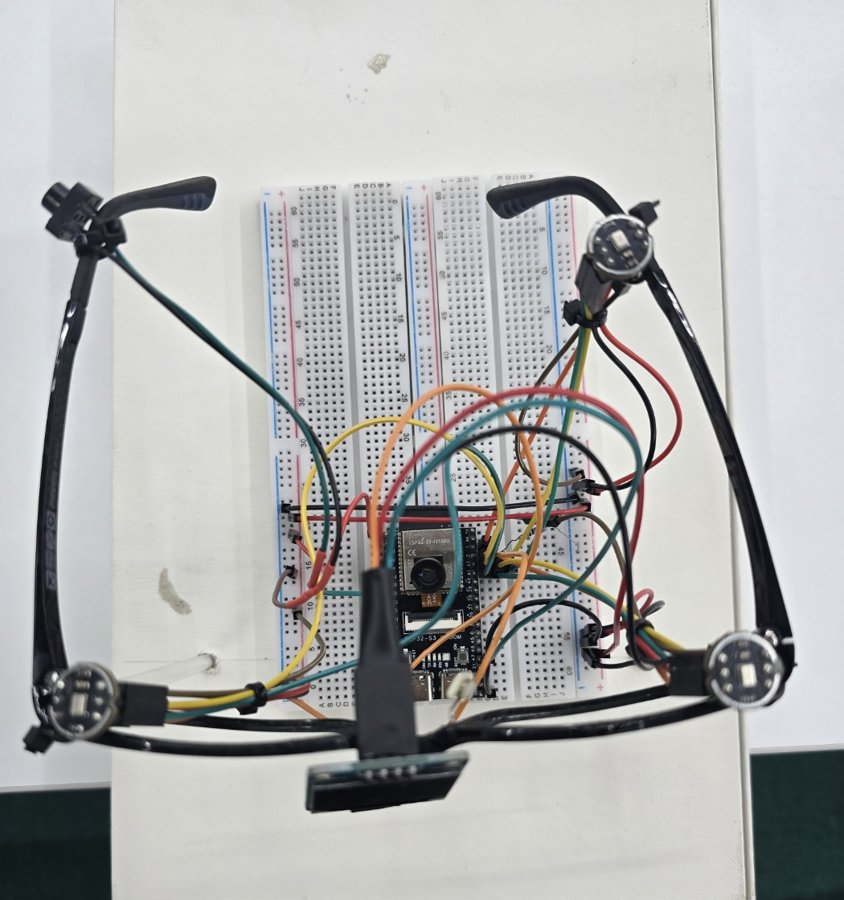
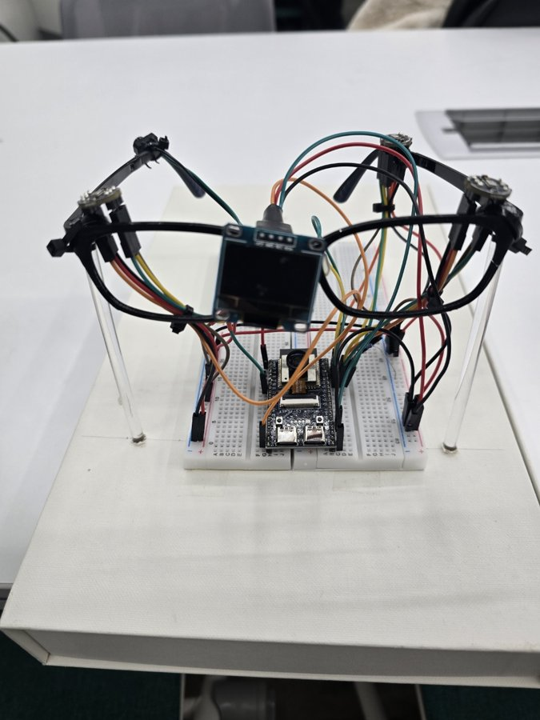
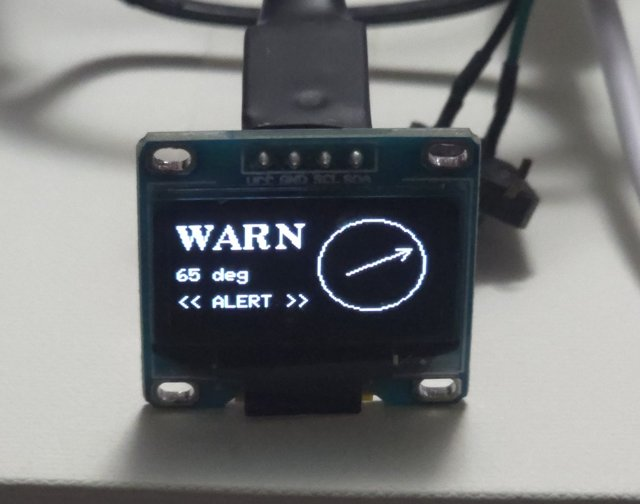
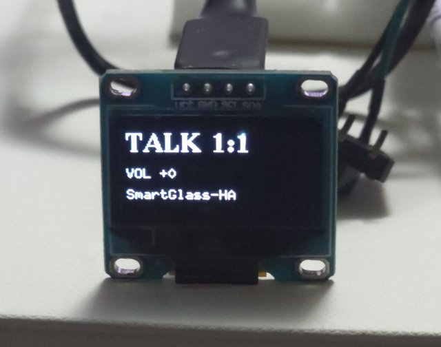
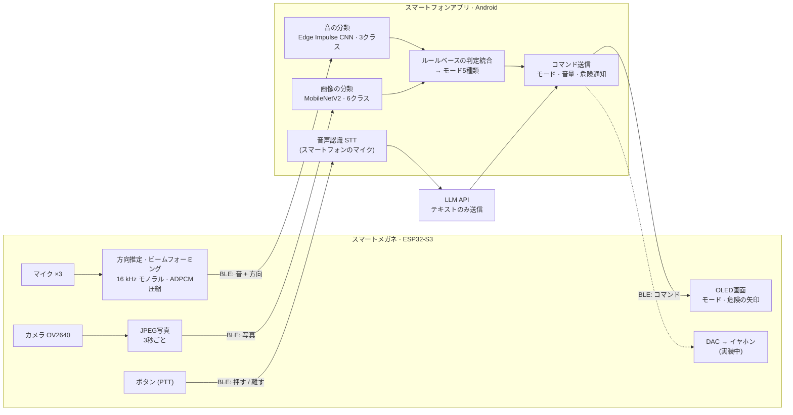
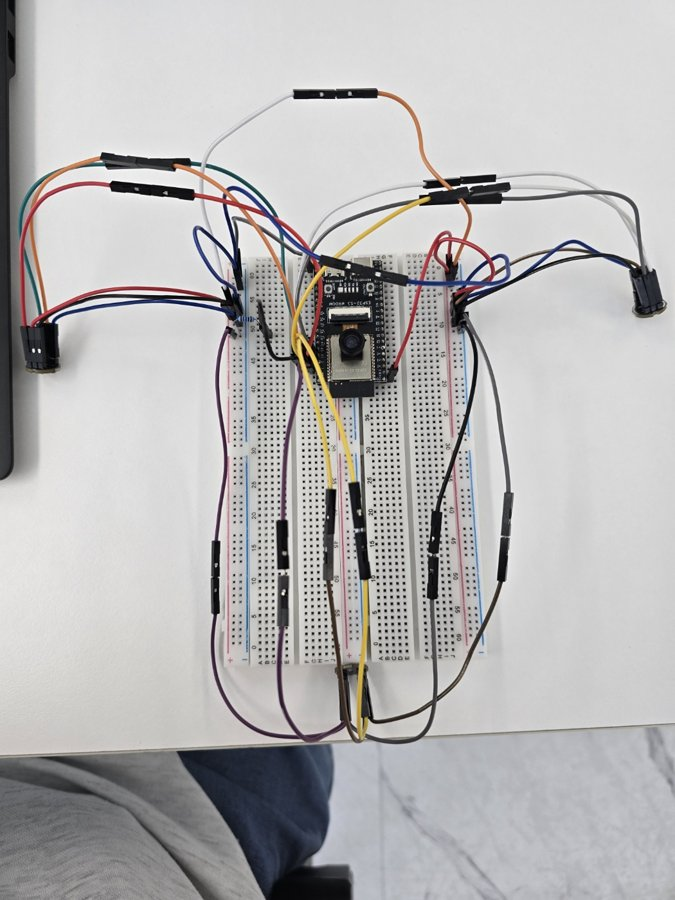
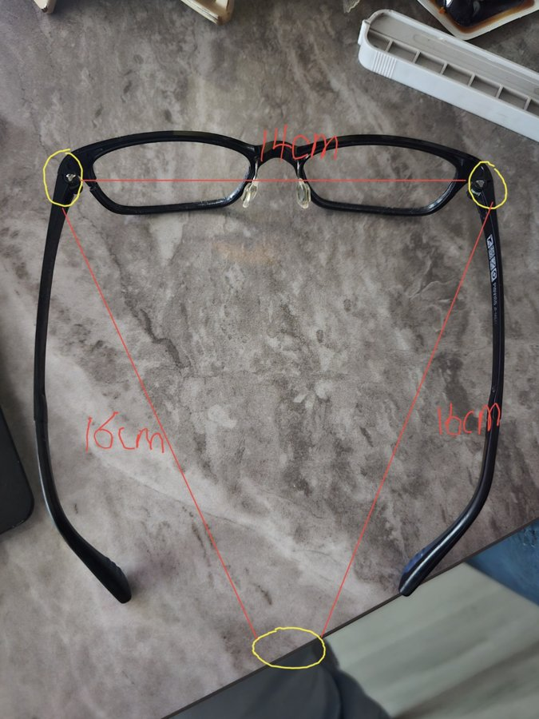

# AIスマートメガネ型補聴器 · Context-Aware Hearing Glasses

[한국어](README.md) | **日本語**

> カメラと3つのマイクで今の状況を読み取り、聞こえ方のモードを自動で切り替え、
> 目に見えない場所の危険な音がどの方向から来たのかを目の前に表示する、メガネ型補聴器の試作品です。

漢陽女子大学校 ソフトウェア融合科 2026年度 キャップストーンデザイン · **チーム 들어조**

| 上から見た試作品（下側がメガネの前面） | 正面 |
|:---:|:---:|
|  |  |

マイクは前側の左右（ヒンジ付近）に2個、左のテンプル（つる）の先端に1個、合計3個です。上から見た写真では、右上のマイクが左テンプルの先端にあります。

> ソースコード内のコメントと `docs/` のドキュメントは韓国語で書かれています。

**目次**: [なぜ作ったのか](#1-なぜ作ったのか) · [何ができるのか](#2-何ができるのか) · [どう動くのか](#3-どう動くのか) · [測定結果](#4-測定結果) · [開発の歩み](#5-開発の歩み) · [現状と計画](#6-現状と今後の計画) · [チーム](#7-チームと協働) · [用語の解説](#8-用語の解説) · [ビルド](#9-リポジトリ構成とビルド) · [過去の作業](#10-過去の作業の保管)

---

## 1. なぜ作ったのか

**補聴器を持っていても、使われていません。** うるさい場所では雑音まで大きくなり、小さくてなくしやすく、着けていると目立つからです。

| 数値 | 内容 | 出典 |
|:---:|---|---|
| **20.0%** | 65歳以上の人口の割合（1,024万人）。韓国は超高齢社会に入りました | 韓国 行政安全部 住民登録人口統計、2024年12月23日時点 |
| **52.9%** | 70代以上の男性における中等度以上の難聴の有病率（女性は40.7%） | 韓国 疾病管理庁 国民健康栄養調査 2019〜2023年 聴覚検査の分析、40歳以上が対象 |
| **39%** | 50歳以上の自己申告による聴力低下。28か国中2位。一方で補聴器の使用率は最も低い4か国（1.0〜5.9%）に入っています | BMJ Global Health 2025;10(10):e017655 |

そこで、**いつも掛けているメガネに補聴器を組み込みました。** メガネなのでなくすことも、人目を気にすることも減ります。さらに、状況を自動で読み取る機能を加えました。

## 2. 何ができるのか

### 聞こえ方のモード 5種類

**屋内基本 · 屋外基本 · テレビ視聴 · 1対1の会話 · 多人数の会話**

モードは3つの方法で切り替わります。状況に応じて自動で切り替わるほか、音声コマンドやスマートフォンアプリのボタンでも切り替えられます。

### 主な機能 4つ

| | 機能 | 仕組み |
|:---:|---|---|
| 1 | **状況を読み取ってモードを切り替える** | 3秒ごとに撮った写真と2秒単位の音を、それぞれAIで分類します。2つの結果をあらかじめ決めたルールで組み合わせ、5つのモードから1つを選びます。 |
| 2 | **モードに合わせて整えた音** | 3つのマイクの音を[ビームフォーミング](#8-用語の解説)で合成し、低い帯域（風の音など）をカットします。[DAC](#8-用語の解説)を通してイヤホンに出力します。*（イヤホン出力部は実装中）* |
| 3 | **視界の外の危険を方向で知らせる** | 危険な音と判定されると、音が来た方向（[方位角](#8-用語の解説)）を計算し、メガネのOLED画面に矢印を3秒間表示します。 |
| 4 | **ボタンひとつ、ひとこと** | メガネのボタンを押して話すと、スマートフォンが音声を文字に変換し、LLMがあらかじめ決めた10種類のコマンド（[インテント](#8-用語の解説)）のどれかに分類して、モードと音量を変更します。 |

<sub>リンクになっている用語を押すと、[8. 用語の解説](#8-用語の解説)に移動します。</sub>

| 危険な音の方向表示（65°方向） | モード表示（1対1の会話、音量） |
|:---:|:---:|
|  |  |

## 3. どう動くのか

**メガネが音と写真を集めて整え、スマートフォンが状況を分類・判断します。** 両者はBLE 5.0（低消費電力のBluetooth）で直接つながるため、音声コマンドを除けばインターネットなしで動作します。



- **AIの推論はすべてスマートフォンの中で**行います（[オンデバイス](#8-用語の解説)）。受信した写真と音は保存しません。
- インターネットを使うのは音声コマンドの意図分類だけで、そのときも**音声ではなく、認識したテキストだけ**を送ります。
- 音声認識にメガネのマイクではなくスマートフォンのマイクを使うのには理由があります。Androidの音声認識は外部の音声を入力として受け取れず、ESP32-S3には通話用のBluetooth（HFP）がありません。

### 技術スタック

| 分野 | 使用技術 |
|---|---|
| ファームウェア | C/C++ · Arduino-ESP32 3.3.11（ESP-IDF 5.5.5、FreeRTOS）· PlatformIO · NimBLE-Arduino 2.5.0 · U8g2 · esp32-camera |
| スマートフォンアプリ | Kotlin · Android（minSdk 26）· LiteRT 1.4.0（TensorFlow Lite）· OkHttp · Androidの音声認識（SpeechRecognizer） |
| AIモデル | MobileNetV2（画像）· Edge Impulse MFE + CNN（音）· LLM API（音声コマンドの意図分類） |
| 通信 | BLE 5.0（製品）· WiFi UDP/TCP（実験・デバッグ） |
| PCツール | Python（NumPy、SciPy、bleak、pyserial）· C++（リアルタイム試聴） |

### ハードウェア

| 部品 | 役割 |
|---|---|
| ESP32-S3ボード（N16R8、カメラコネクタ内蔵） | メガネの頭脳。音と写真の収集、信号処理、無線送信 |
| INMP441 デジタルマイク ×3 | 前側の左右に2個 + 左テンプルの先端に1個。[48 kHz](#8-用語の解説)で同時に録音 |
| OV2640 カメラ | 装着者の前の光景を撮影（JPEG、モノクロ送信オプションあり） |
| SSD1306 OLED 0.96" | 現在のモードと危険な方向の矢印を表示 |
| ボタン | 音声コマンドの開始・終了（[PTT](#8-用語の解説)） |
| PCM5102A DAC | イヤホン出力 *（実装中）* |

### 通信

- 製品構成は **BLE 5.0** です。同じファームウェアを **WiFi** でもビルドできますが、こちらはスループットの比較実験とデバッグにだけ使います。
- 音・写真・ボタン・コマンドは、すべて同じ形式のフレームでやり取りします。
  `[A5 5A][種類][フラグ][通し番号 u16][長さ u16][内容][CRC16]`
  - 通し番号で、届かなかったパケットを数えます。
  - CRC16は、内容が壊れていないかを確かめるチェック値です。

## 4. 測定結果

試作段階で実際に測った値です。**条件もあわせてご覧ください。**

### 音の方向推定

| 結果 | 条件 |
|---|---|
| 8方向の**平均誤差 9.15°、最大 15.15°** | 2026年9月10日、**以前の配置である14 cmの正三角形**で測定。メガネを装着し、音源までの距離は1 m、方向ごとにスナップ音を1回録音。PCのプロトタイプで計算しました。ゲートの調整に同じ録音を使ったため、独立した検証はまだです。 |

- 角度は装着者の正面を0°とし、時計回りに測ります。
- 現在の配置（左テンプルの先端のマイク）では、まだ測り直していません。

### Bluetoothでの音声送信

| 結果 | 条件 |
|---|---|
| 干渉があるときのパケット損失率：元の音声（PCM）**28.4% → ADPCM圧縮 0.00%** | 音声だけを送った場合。干渉源は同じPCの2.4 GHz WiFiホットスポット |
| 写真1枚の送信時間 **4〜6秒 → 0.4〜0.7秒** | 干渉がある状態で、PCMとADPCMを比較 |
| 干渉がないときの音声+写真の同時送信：**ADPCM 0.00%**、PCM 2.84% | 写真は3秒ごとに一緒に送信 |
| ADPCM圧縮の後も、音分類モデルの判定が **97.6% 一致** | PCでのシミュレーション |

- 受信はPC（BLEドングル）で行い、条件ごとに1〜2回測定しました。
- まとめると、音声を4分の1に圧縮（[ADPCM](#8-用語の解説)）したところ途切れが大きく減り、分類結果はほとんど変わりませんでした。

### AIモデル

| モデル | 結果 | 条件 |
|---|---|---|
| 画像による状況分類（MobileNetV2、6クラス） | **95%** / **72.3%** | 95%は学習に使った元画像250枚での値です。72.3%は学習に使っていないWeb画像65枚（[独立セット](#8-用語の解説)）での値で、こちらのほうが実際の性能に近いです。モノクロ224×224入力。テレビと危険のシーンはデータの補強が必要です（独立セットで危険シーンは0/6） |
| 音による状況分類（Edge Impulse CNN、3クラス） | 正解率 **88.3%**、危険音の[再現率](#8-用語の解説) **84%** | Edge Impulseのテストセット、[float32](#8-用語の解説)モデル基準。危険・騒音・話し声それぞれ1,000クリップ（2.0秒、16 kHz）。正規化・ラベル・特徴抽出をあわせて見直し、68% → 88%に向上しました |

## 5. 開発の歩み

2026年3月の企画から現在までの流れです。4〜9月のチームメンバーの作業は、[`archive/*` タグ](#10-過去の作業の保管)にそのまま残っています。機能ごとの仕様・結果・過程は[機能別の文書](#機能別の文書)（韓国語）にまとめました。

| 8月 · ブレッドボード配線 | 8月末 · マイク配置の最初のスケッチ（その後変更） | 11月 · 現在の試作品 |
|:---:|:---:|:---:|
|  |  |  |

<details>
<summary>月ごとの歩みを見る（3月〜11月）</summary>

**3月 · 企画と要求分析**
- 補聴器が使われない理由（雑音・紛失・見た目）から出発し、メガネ型の構成と主な機能4つを決めました。→ `docs/요구분석명세서_ver1.pdf`

**4月 · チームのリポジトリを開始**
- リポジトリを作り、ファームウェア・音のモデル・画像のモデル・音声コマンドに役割を分けました。→ `archive/2026-04-skeleton`

**5月 · 最初のプロトタイプ：サーバーで分析する方式**
- スマートフォンアプリが録音した音声をサーバー（FastAPI）に送り、サーバーがWhisper・Geminiで音声認識と状況分析を行う方式を試しました。→ `archive/2026-05-app-fastapi-whisper`、`archive/2026-05-app-fastapi-gemini`
- Teachable Machineで画像による状況判断を試しました。→ `archive/2026-05-image-teachable-machine`
- ESP32-S3ボードの動作と、アナログマイク（MAX4466）の入力の読み取りを初めて試したファームウェアを作りました。→ `archive/2026-05-firmware-mic-proto`

**6月 · アナログマイクで方向検出の練習**
- アナログマイク（MAX4466）で録音ファイルを保存し、3つのマイクで音の方向を左・中央・右に分けてOLEDに表示しました。→ `archive/2026-06-firmware-max4466-recording`、`archive/2026-06-firmware-3mic-oled`
- 音の学習テスト用アプリを作りました。→ `archive/2026-06-sound-learning-app`

**7月 · 設計の確定、ハードウェアが初めて動作**
- チームメンバーのモデル仕様3つをまとめ、全体の構成を設計し直しました。AIはサーバーではなくスマートフォンの中で動かし、メガネとスマートフォンの間の通信規格を先に決めました。
- デジタルマイク（INMP441）3つを2本の[I2S](#8-用語の解説)バスに分けてつなぎ、クロックを共有して3チャンネルを同時に録音しました。WiFiでのストリーミングとBLEでの最初の送信まで確認しました。→ `firmware/`、`tools/`
- Edge Impulseで作った音分類アプリができました。→ `archive/2026-07-sound-edge-impulse-app`

**8月 · カメラ、画面、テストアプリ**
- カメラ撮影（JPEG）、OLED画面（モード・方向の矢印）、Androidのテストアプリ（WiFi・BLE受信）を作りました。
- BLEの接続間隔を短くし、音声の損失を減らしました。
- MobileNetV2の画像分類モデルができました。→ `archive/2026-08-image-camera-mobilenet`

**9月 · メガネに取り付けて実測し、アプリにモデルを統合**
- メガネにマイクを仮止めし、装着したまま8方向を測定しました。方向推定とビームフォーミングをファームウェア（C言語）に移しました。
- ADPCM圧縮を入れ、干渉があるときの音声の損失を大きく減らしました。
- Galaxy S24 Ultraと接続し、アプリに画像分類 → 音声コマンド（LLM）→ モードの自動切り替えを順に組み込みました。
- 音モデルの配布版v5ができました。→ `archive/2026-09-sound-model-v5`

**10月 · 音モデルの統合、コンテスト1次審査**
- 音モデルをアプリに組み込み、画像と音をあわせて判断する仕組みを完成させました。画像モデルがモノクロで学習されていたことを確認し、カメラとアプリの入力をモノクロにそろえました。
- 音の前処理の誤りを見つけて直し、学習に使っていないWeb画像65枚で画像モデルを別途評価しました。
- インターネットなしでも使えるように、製品の通信をBLEに確定しました。
- 2026「地域革新人材育成」連合フェスティバルのコンテストに出品し、1次審査を通過しました。

**10〜11月 · 配置の変更と発表の準備**
- マイクの配置を、前側の左右2個 + 左テンプルの先端1個に変更しました。
- イヤホン出力用のDACを用意しました。
- 2次審査用の発表動画と最終発表のポスターを作り、このリポジトリを整理して公開しました。

<sub>7〜11月のファームウェア・アプリの作業は当時gitで管理していませんでした。そのため、このリポジトリには残っていた2つの時点、2026-10-01のバックアップのスナップショットと2026-11-09の最終版として入っています。10月1日のコミットにはチームメンバー3人が作ったモジュール（音声コマンド・画像モデル・音モデル）が初めて入るため、3人を共同作成者として表示しました。その後、機能別のPR（#1〜#4）で、この時期の作業をファイルごとの最終更新時刻と作成者で分けてコミットし直しました。数値の結果は[4. 測定結果](#4-測定結果)と機能別の文書にあります。</sub>

</details>

## 6. 現状と今後の計画

**確認できたこと**
- Galaxy S24 UltraとBLEで接続し、波形・写真・分類・モード表示までの一連の流れを確認しました（開発ログに基づく）。
- アプリが送った危険通知のコマンドが、メガネのOLEDに矢印として表示されます。
- 音声コマンドはLLMのインテント10種類で動作します。正解率が低かった初期の小型モデルから切り替えました（[機能4の文書・韓国語](docs/features/4-voice-command.md#측정)）。

**今後の計画**
- **イヤホン出力の仕上げ**：DACの接続、出力遅延の測定
- **分類モデルのチューニング**：メガネで集めた写真と音で再学習・再評価
- **変更したマイク配置への対応**：マイクの座標を測り直し、メガネ上で8方向の誤差を再測定
- 危険通知の遅延測定、統合による効果の比較、バッテリーの一体化、音声コマンドの試験（199文）

スマートフォン実機での分類精度と、BLE・WiFiの比較実験の全体は、まだ測定していません。

## 7. チームと協働

| 名前 | 担当 |
|---|---|
| チョン・ヒョウォン（정효원） | 代表 · チームリーダー · ファームウェア · アプリ統合 |
| ソン・チェウォン（송채원） | 音声コマンド（音声認識 → LLM） |
| チェ・ダヒョン（최다현） | 画像による状況分類モデル |
| アン・ホヨン（안호연） | 音による状況分類モデル |

**協働の進め方**
- 通信の規格とパケットの仕様を先に確定して共有しました。PC用の受信ツールを作り、アプリがなくても各自が並行して開発できるようにしました。
- モデルを受け取るときに入力仕様（前処理・色空間・ランタイムのバージョン）を確認し、アプリに合わせました。
- 要求分析の受け入れ条件を試験の基準とし、達成状況をそのまま記録しました。

## 8. 用語の解説

| 用語 | 意味 |
|---|---|
| **ビームフォーミング**（delay-and-sum） | マイクごとに音が届く時刻は少しずつ違います。その差をそろえて足し合わせる手法です。狙った方向の音は大きくなり、ほかの方向の雑音は相対的に小さくなります。 |
| **方位角 / DOA** | DOA（Direction of Arrival）は音が来た方向です。方位角はその方向を角度で表した値です。 |
| **GCC-PHAT / SRP-PHAT** | 方向を求める計算方法です。GCC-PHATは2つのマイクの信号を比べて、到達時間の差を求めます。SRP-PHATはその結果を複数の方向候補に当てはめ、最ももっともらしい方向を選びます。残響のある部屋でも比較的安定しています。 |
| **サンプリング周波数**（48 kHz / 16 kHz） | 1秒間に音を何回測るかを表します。方向推定ではごく小さな時間差を測る必要があるため、48 kHzで録音します。分類モデルの入力に合わせて16 kHzに落としてから送ります。 |
| **ADPCM**（IMA ADPCM、4:1） | 音のサンプル1つを16ビットから4ビットに減らす、シンプルな圧縮方式です。計算が軽いのでメガネの小さなチップでもリアルタイムに動き、送信量が4分の1になります。 |
| **BLE 5.0** | 低消費電力のBluetooth（Bluetooth Low Energy）です。スマートフォンと直接つながるため、ルーターやインターネットは不要です。 |
| **パケット損失率** | 送ったデータのまとまり（パケット）のうち、届かなかったものの割合です。通し番号の抜けを数えて求めます。 |
| **PTT**（Push-to-Talk） | トランシーバーのように、ボタンを押している間だけ話を受け付ける方式です。 |
| **STT**（Speech-to-Text） | 音声を文字に変換する音声認識です。スマートフォンのAndroid音声認識を使います。 |
| **LLMによるインテント分類** | 話の「意図」を、あらかじめ決めたコマンドのどれかに振り分けることです。たとえば「音を大きくして」はVOLUME_UPに分類します。コマンドは、音量の上げ下げ2種類、モード切り替え5種類（テレビ・1対1・多人数・通話・屋外）、自動モードのオン・オフ2種類、「該当なし」1種類の計10種類です。 |
| **MobileNetV2** | スマートフォンのような軽い機器でも速く動くように設計された、画像分類のニューラルネットワークです。 |
| **Edge Impulse · MFE · CNN** | Edge Impulseは、小型機器向けのAIモデルを作るプラットフォームです。MFE（Mel-filterbank Energy）は、音を人の耳の周波数の感じ方に合わせた帯域ごとのエネルギーの図に変える特徴抽出の方法です。CNNは、その図からパターンを見つけるニューラルネットワークです。 |
| **ルールベースの判定統合**（late fusion） | 画像モデルと音モデルがそれぞれ結論を出したあと、あらかじめ決めた表で最終的なモードを決める方式です。たとえば写真が「屋内」、音が「会話」なら「1対1の会話」になります。2つのモデルを1つにまとめて学習したものではありません。 |
| **オンデバイスAI** | データをサーバーに送らず、スマートフォンの中で直接AIの計算をすることです。 |
| **正解率 · 再現率** | 正解率は、全体のうち正しく当てた割合です。再現率は、実際の危険な音のうち「危険」と正しく当てた割合で、危険を見逃さない力を表します。このプロジェクトでは再現率が特に重要です。 |
| **独立セット** | 学習に一度も使っていないデータです。これで測ることで、実際の利用環境に近い性能がわかります。 |
| **float32 · INT8** | モデルの中の数値を保存する精度です。INT8に落とす（量子化する）とモデルが小さく速くなりますが、結果が少し変わることがあります。アプリにはINT8モデルを入れており、88.3%はfloat32モデルでの値です。 |
| **DAC** | デジタルの音声データを、イヤホンで再生できるアナログ信号に変換する部品です。 |
| **I2S · DVP · I2C** | チップと部品をつなぐ通信方式です。I2Sはデジタル音声（マイク）、DVPはカメラ映像、I2CはOLEDのような低速な機器に使います。 |
| **NVS** | ESP32の中にある小さな保存領域です。WiFiの接続情報のように、電源を切っても残す必要がある設定を保存します。 |

## 9. リポジトリ構成とビルド

### フォルダ構成

| パス | 内容 |
|---|---|
| `firmware/` | ESP32-S3ファームウェア：音声キャプチャ、方向推定・ビームフォーミング、カメラ、BLE/WiFi送信、OLED画面 |
| `android/` | 統合Androidアプリ：受信、音・画像の分類、モード決定、音声コマンド |
| `ptt_module/` | 音声コマンドのインテント分類の単体モジュール（アプリに移す前のオリジナル） |
| `image_model/` | 画像分類モデル（`imageModel.tflite`）とPCカメラのデモ |
| `sound_model/` | Edge Impulse音分類モデルのパラメータとTFLiteモデル |
| `tools/` | PCツール：受信ツール、方向推定・ビームフォーミングのプロトタイプ、同期検証、評価スクリプト |
| `docs/` | 機能別の文書（`docs/features/`、韓国語）、要求分析仕様書、配線ガイド、試験文書、モデルの意思決定記録 |
| `cmd_list.md` | ビルド・シリアルコマンド・PCツールの使い方のまとめ |

### 機能別の文書

主な機能4つごとに、**仕様（最初に決めた要件）・最終結果・開発の過程・関連ファイル**を別にまとめました（韓国語）。各機能の開発履歴はPRでmainに統合しました。

| 文書 | 機能 | 担当 | 履歴 |
|---|---|---|---|
| [機能1](docs/features/1-situation-mode.md) | 状況を読み取ってモードを切り替える（画像・音の分類 → モード決定） | チェ・ダヒョン · アン・ホヨン · チョン・ヒョウォン | [PR #1](https://github.com/hy0w0n/context-aware-hearing-glasses/pull/1) |
| [機能2](docs/features/2-beamforming-sound.md) | モードに合わせて整えた音（マイク3つの録音、ビームフォーミング、圧縮・送信） | チョン・ヒョウォン | [PR #2](https://github.com/hy0w0n/context-aware-hearing-glasses/pull/2) |
| [機能3](docs/features/3-danger-direction.md) | 視界の外の危険の方向表示（方向推定、OLEDの矢印） | チョン・ヒョウォン · アン・ホヨン | [PR #3](https://github.com/hy0w0n/context-aware-hearing-glasses/pull/3) |
| [機能4](docs/features/4-voice-command.md) | ボタンひとつ、ひと言で（ボタン → 音声認識 → LLM → コマンド） | ソン・チェウォン · チョン・ヒョウォン | [PR #4](https://github.com/hy0w0n/context-aware-hearing-glasses/pull/4) |

7〜11月の作業は当時gitで管理していなかったため、残っていたファイルのバージョンを、ファイルごとの最終更新時刻と作成者でコミットしました（2026-11-09に整理）。5〜7月の初期試作は`archive/*`タグの元のコミットを移しました。

### 1) 秘密情報の設定（最初に）

LLM APIのキーはリポジトリに含めていません。リポジトリのルートに `.env` を作っておくと、2つのAndroidプロジェクトがビルド時に読み込みます。

```bash
cp .env.example .env
# .env を開き、LLM_API_KEY= の後ろにキーを書きます（.env は .gitignore で除外されています）
```

### 2) ファームウェア

[PlatformIO Core](https://platformio.org/install/cli) が必要です。
- プラットフォームは pioarduino 55.03.311（Arduino-ESP32 3.3.11 + ESP-IDF 5.5.5）に固定しています。
- ボードはESP32-S3 N16R8（フラッシュ16 MB、PSRAM 8 MB）です。

```bash
pio run -d firmware -e ble  -t upload   # 製品構成 (BLE)
pio run -d firmware -e wifi -t upload   # 実験・デバッグ (WiFi)
pio device monitor -b 115200
```

WiFiビルドでは、シリアルで `wifi <SSID>;<パスワード>` と入力して接続情報を[NVS](#8-用語の解説)に保存します。コードには含まれていません。

### 3) Androidアプリ

`android/` をAndroid Studioで開くか、Gradle 9.3.1以降でビルドします（AGP 8.13、minSdk 26）。

```bash
gradle -p android assembleDebug
# 出力: android/app/build/outputs/apk/debug/app-debug.apk
```

- `ptt_module/` は同梱のGradle Wrapperでビルドします（`./gradlew assembleDebug`）。
- アプリの［🖼 컬러 vs 흑백］（カラー vs モノクロ）テストボタンは `android/app/src/main/assets/test_img1~3.jpg` を使います。元の写真には人が写っているため、リポジトリからは除外しました。自分で撮った写真を入れると動作し、ない場合は「시험 실패」（テスト失敗）のログが出るだけです。

### 4) PCツール

Python 3.10以上が必要です。スクリプトごとに必要なパッケージが異なり、主に `numpy`、`scipy`、`pyserial`、`bleak`、`ai-edge-litert` を使います。

```bash
python tools/receiver.py        # WiFi UDP音声の受信 → WAV保存、ドロップ統計
python tools/ble_receiver.py    # BLE音声の受信
python tools/doa_prototype.py   # 3チャンネルWAVで方向推定を検証
```

詳しい使い方は `cmd_list.md` にあります。文書内の絶対パスは開発PC基準です。

## 10. 過去の作業の保管

初期の実験ブランチと、GitHubに上げていなかった5月のローカルのプロトタイプを、`archive/*` タグとして残しました。
- これらのタグの履歴はmainにマージされているため、チームメンバーのコミットもそのまま表示されます。
- 公開前に、ハードコードされていたAPIキーを履歴から削除しました。

<details>
<summary>タグの一覧を見る（11個）</summary>

| タグ | 元のブランチ | 内容 |
|---|---|---|
| `archive/2026-04-skeleton` | feature/Awareness | 初期フォルダ構成の骨組み |
| `archive/2026-05-app-fastapi-whisper` | feature/app | 初期アプリ + FastAPI（Whisper STT + LLMによる状況分析） |
| `archive/2026-05-app-fastapi-gemini` | feature/app2 | アプリ + FastAPI（Gemini STT + 状況分析） |
| `archive/2026-05-firmware-mic-proto` | （ローカルのコピー） | ESP32-S3の動作・アナログマイク入力の最初の試験 |
| `archive/2026-05-image-teachable-machine` | feature/image_analysis | Teachable Machineによる画像の状況判断 |
| `archive/2026-06-firmware-max4466-recording` | feature/Firmware | MAX4466アナログマイクの録音プロトタイプ |
| `archive/2026-06-firmware-3mic-oled` | feature/firmPractice | アナログマイク3個による方向推定 + OLED |
| `archive/2026-06-sound-learning-app` | feature/SoundLearningTest | 音の学習テスト用アプリ |
| `archive/2026-07-sound-edge-impulse-app` | SmartHearing_Edge | Edge Impulse SDKを使った音分類アプリ |
| `archive/2026-08-image-camera-mobilenet` | feature/camera | MobileNetV2画像モデル + カメラのデモ |
| `archive/2026-09-sound-model-v5` | AIModel | Edge Impulse音モデルの配布版 v5（SDKを含むzip） |

```bash
git fetch --tags
git checkout archive/2026-06-firmware-3mic-oled
```

</details>
