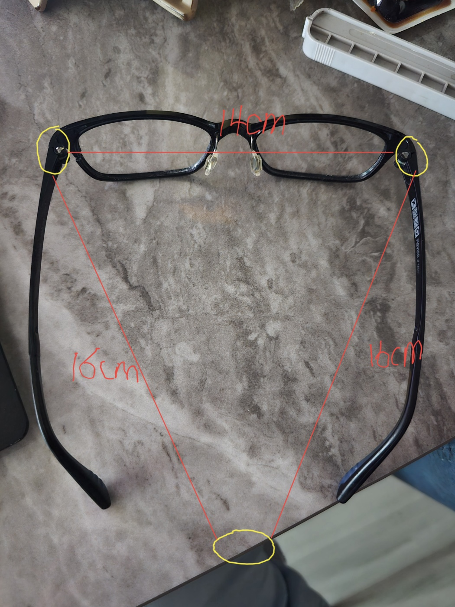
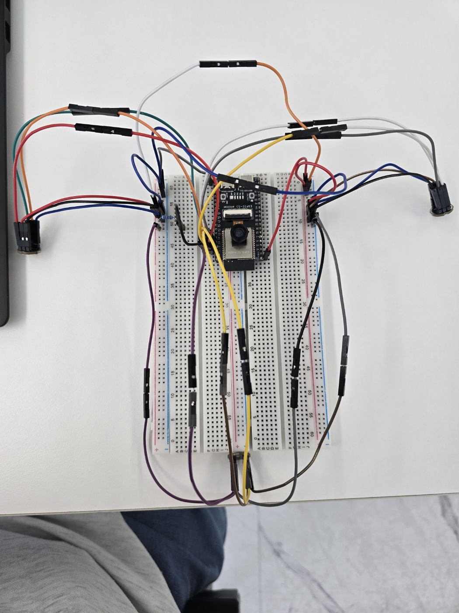

# Context-Aware Hearing Glasses — AI 스마트 안경형 보청기

**한국어** | [日本語](README.ja.md)

한양여자대학교 소프트웨어융합과 2026 캡스톤 디자인 · 팀 들어조

노인성 난청 사용자를 위한 안경형 보청기 시제품입니다. 안경에 붙은 ESP32-S3가 마이크 3개와 카메라로 주변 소리와 장면을 모으고, 스마트폰 앱의 AI 모델이 지금 상황을 판단해 보청기 모드를 바꿉니다.

| 마이크 3개 배치 초기 설계 (실제 실장은 14 cm 정삼각형) | 브레드보드 배선 |
|:---:|:---:|
|  |  |

## 주요 기능

1. **소리 방향 추정 + 빔포밍**: INMP441 마이크 3개를 48 kHz로 동시 캡처해 GCC-PHAT/SRP-PHAT로 방향을 구하고, delay-and-sum 빔포밍 후 16 kHz mono로 줄여 방향 정보와 함께 폰으로 보냅니다.
2. **상황 인식 모드 전환**: 이미지 분류(MobileNetV2, 6클래스)와 소리 분류(Edge Impulse MFE+CNN, 3클래스) 결과를 규칙 기반으로 결합해 실내 기본 / 야외 기본 / TV 시청 / 일대일 대화 / 다인 대화 모드를 고릅니다.
3. **시야 밖 위험 소리 알림**: 위험 소리가 나면 안경의 OLED에 아이콘과 방향 화살표를 띄웁니다.
4. **음성 명령(PTT)**: 안경 버튼을 누르고 말하면 폰이 음성을 텍스트로 바꾸고, LLM이 의도를 분류해 음량과 모드를 바꿉니다.

이어폰 출력(로컬 패스스루)은 DAC(PCM5102A)를 확보했고 구현을 앞두고 있습니다.

## 시스템 구성

```
[안경: ESP32-S3]                                   [스마트폰: Android 앱]
 INMP441 ×3 ─ I2S ─ 3ch 캡처 → 방향 추정 → 빔포밍     ┌ 소리 분류 (Edge Impulse, 2초 창)
                     → 16 kHz mono (IMA ADPCM)      ├ 이미지 분류 (MobileNetV2)
 OV2640 ──── DVP ─── 주기 JPEG 캡처                  ├ 규칙 기반 결합 → 모드 결정
 버튼(PTT) ─ GPIO ── 이벤트                          └ 음성 명령: 폰 STT → LLM 인텐트 분류
                         │                                   │
                         └──── BLE 5.0 (제품 구성) ───────────┘
                               WiFi (실험·디버깅용)
 OLED ◄── 명령 수신: SET_MODE / SET_VOLUME / DISPLAY_ALERT
```

- 제품 구성의 통신은 인터넷 없이 쓸 수 있는 BLE 5.0입니다. WiFi 빌드는 처리량 비교 실험과 디버깅에 씁니다.
- 펌웨어는 PlatformIO 환경 두 개(`env:ble`, `env:wifi`)로 나눠 빌드합니다.
- 통신 프레임: `[A5 5A][type][flags][seq u16][len u16][payload][crc16]` (오디오·이미지·이벤트·명령·PING 공통)

## 저장소 구조

| 경로 | 내용 |
|---|---|
| `firmware/` | ESP32-S3 펌웨어 (오디오 캡처, DSP, 카메라, BLE/WiFi 전송, OLED UI) |
| `android/` | 통합 안드로이드 앱 (수신, 소리·이미지 분류, 모드 결정, 음성 명령) |
| `ptt_module/` | 음성 명령 인텐트 분류 단독 모듈 (앱에 이식하기 전 원본) |
| `image_model/` | 이미지 분류 모델(`imageModel.tflite`)과 PC 카메라 데모 |
| `sound_model/` | Edge Impulse 소리 분류 모델 파라미터와 TFLite 모델 |
| `tools/` | PC 도구: 수신기, 방향 추정·빔포밍 프로토타입, 동기 검증, 평가 스크립트 |
| `docs/` | 요구분석명세서, 배선 가이드, 시험 문서, 모델 의사결정 기록 |
| `cmd_list.md` | 빌드·시리얼 명령·PC 도구 사용법 모음 |

## 빌드와 실행

### 비밀 값 설정 (먼저)

LLM 게이트웨이 키는 저장소에 넣지 않습니다. 저장소 루트에 `.env`를 만들어 두면 두 안드로이드 프로젝트가 빌드할 때 읽어 갑니다.

```bash
cp .env.example .env
# .env 파일을 열어 LLM_API_KEY= 뒤에 키를 적습니다 (.env는 .gitignore로 제외됨)
```

### 펌웨어

[PlatformIO Core](https://platformio.org/install/cli)가 필요합니다. 플랫폼은 pioarduino 55.03.311(Arduino-ESP32 3.3.11 + ESP-IDF 5.5.5)로 고정되어 있습니다. 보드는 ESP32-S3 N16R8입니다.

```bash
pio run -d firmware -e ble  -t upload   # 제품 구성 (BLE)
pio run -d firmware -e wifi -t upload   # 실험·디버깅 (WiFi)
pio device monitor -b 115200
```

WiFi 빌드는 시리얼에서 `wifi <SSID>;<비밀번호>`로 접속 정보를 저장합니다(NVS). 코드에는 들어 있지 않습니다.

### 안드로이드 앱

`android/`를 Android Studio로 열거나 Gradle 9.3.1 이상으로 빌드합니다(AGP 8.13, minSdk 26).

```bash
gradle -p android assembleDebug
# 결과: android/app/build/outputs/apk/debug/app-debug.apk
```

`ptt_module/`은 동봉된 Gradle Wrapper로 빌드합니다(`./gradlew assembleDebug`).

앱의 [🖼 컬러 vs 흑백] 시험 버튼은 `android/app/src/main/assets/test_img1~3.jpg`를 씁니다. 원본 사진에 사람이 찍혀 있어 저장소에서는 뺐으므로, 직접 찍은 사진을 넣어야 동작합니다. 없으면 '시험 실패' 로그만 남깁니다.

### PC 도구

Python 3.10 이상. 스크립트마다 필요한 패키지가 다르며 주로 `numpy`, `scipy`, `pyserial`, `bleak`, `ai-edge-litert`를 씁니다.

```bash
python tools/receiver.py        # WiFi UDP 오디오 수신 → WAV 저장, 드랍 통계
python tools/ble_receiver.py    # BLE 오디오 수신
python tools/doa_prototype.py   # 3채널 WAV로 방향 추정 검증
```

자세한 사용법은 `cmd_list.md`에 있습니다(문서 안의 절대 경로는 개발 PC 기준입니다).

## 측정 결과 (시제품 단계)

| 항목 | 결과 | 조건 |
|---|---|---|
| 소리 방향 추정 오차 (8방향) | 평균 9.15°, 최대 15.15° | 안경 착용, 음원 1 m, PC(Python) 계산, 방향별 녹음 1개, 독립 검증 전 |
| BLE 오디오 손실률 (간섭 링크, 단독 전송) | PCM 28.4% → IMA ADPCM 0.00% | 수신기는 PC(BLE 동글 + bleak), 간섭원은 같은 PC의 2.4 GHz 핫스팟 |
| BLE 오디오+이미지 동시 전송 (간섭 없는 링크) | ADPCM 0.00%, PCM 2.84% | 같은 조건, 셀당 1~2회 측정 |
| 이미지 분류 정확도 | 95% (원본 250장) / 72.3% (웹 독립 세트 65장) | 250장은 학습 데이터를 포함한 평가. 독립 세트에서 위험 장면은 0/6 |
| 소리 분류 정확도 | 테스트 88.3%, 위험 소리 재현율 84% | Edge Impulse 테스트 세트, float32 모델 기준 |

이 수치는 시제품 단계의 소규모 측정입니다. 폰 실기기 정확도와 BLE/WiFi 비교 실험 전체는 아직 측정하지 않았습니다.

## 팀

| 이름 | 역할 |
|---|---|
| 정효원 | 펌웨어·하드웨어, 앱 통합, 최종 정리 |
| 안호연 | 소리 분류 모델 |
| 최다현 | 이미지 분류 모델 |
| 송채원 | 음성 명령 인텐트 분류 |

## 이전 작업 보관 (`archive/*` 태그)

초기 실험 브랜치는 정리하면서 태그로 남겼습니다. 이 태그들의 이력은 main에 병합되어 있어 팀원들의 커밋도 그대로 보입니다. 공개하기 전에 하드코딩된 API 키를 이력에서 지웠습니다.

| 태그 | 원래 브랜치 | 내용 |
|---|---|---|
| `archive/2026-04-skeleton` | feature/Awareness | 초기 폴더 구조 뼈대 |
| `archive/2026-05-app-fastapi-whisper` | feature/app | 초기 앱 + FastAPI(Whisper STT + LLM 상황 분석) |
| `archive/2026-05-app-fastapi-gemini` | feature/app2 | 앱 + FastAPI(Gemini STT + 상황 분석) |
| `archive/2026-05-image-teachable-machine` | feature/image_analysis | 티처블머신 이미지 상황 판단 |
| `archive/2026-06-firmware-max4466-recording` | feature/Firmware | MAX4466 아날로그 마이크 녹음 프로토타입 |
| `archive/2026-06-firmware-3mic-oled` | feature/firmPractice | 아날로그 마이크 3개 방향 추정 + OLED |
| `archive/2026-06-sound-learning-app` | feature/SoundLearningTest | 소리 학습 테스트 앱 |
| `archive/2026-07-sound-edge-impulse-app` | SmartHearing_Edge | Edge Impulse SDK 소리 분류 앱 |
| `archive/2026-08-image-camera-mobilenet` | feature/camera | MobileNetV2 이미지 모델 + 카메라 데모 |
| `archive/2026-09-sound-model-v5` | AIModel | Edge Impulse 소리 모델 배포본 v5 (SDK 포함 zip) |

```bash
git fetch --tags
git checkout archive/2026-06-firmware-3mic-oled
```
