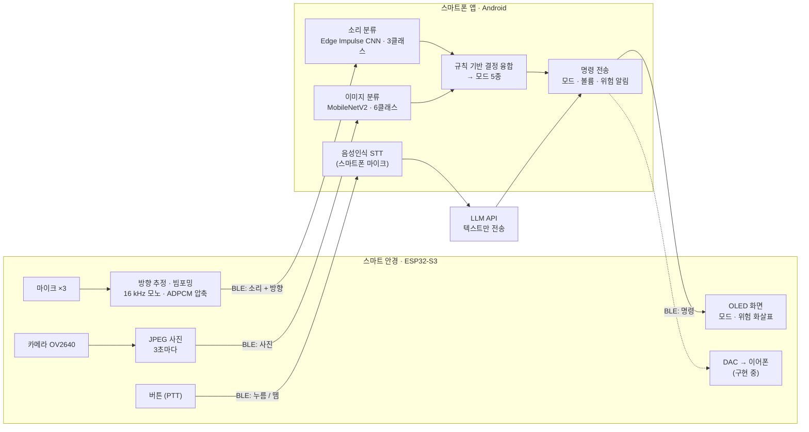

# AI 스마트 안경형 보청기 · Context-Aware Hearing Glasses

**한국어** | [日本語](README.ja.md)

> 카메라와 마이크 3개로 지금 상황을 읽고, 듣기 모드를 알아서 바꾸고,
> 눈에 보이지 않는 곳의 위험 소리가 어느 쪽에서 왔는지 눈앞에 띄워 주는 안경형 보청기 시제품입니다.

한양여자대학교 소프트웨어융합과 2026 캡스톤 디자인 · **팀 들어조**

| 위에서 본 시제품 (아래쪽이 안경 앞면) | 정면 |
|:---:|:---:|
|  |  |

마이크는 앞쪽 양옆(경첩 부근)에 2개, 왼쪽 안경다리 끝에 1개, 모두 3개입니다. 위에서 본 사진에서는 오른쪽 위 마이크가 왼쪽 안경다리 끝에 있습니다.

**목차**: [왜 만들었나](#1-왜-만들었나) · [무엇을 하나](#2-무엇을-하나) · [어떻게 동작하나](#3-어떻게-동작하나) · [측정 결과](#4-측정-결과) · [개발 과정](#5-개발-과정) · [현황과 계획](#6-현황과-다음-계획) · [팀](#7-팀과-협업) · [용어 풀이](#8-용어-풀이) · [빌드](#9-저장소-구조와-빌드) · [이전 작업](#10-이전-작업-보관) · [라이선스](#11-라이선스)

---

## 1. 왜 만들었나

**보청기는 있는데, 쓰지 않습니다.** 시끄러운 곳에서는 잡음까지 커지고, 작아서 잃어버리기 쉽고, 끼고 있으면 티가 나기 때문입니다.

| 수치 | 내용 | 출처 |
|:---:|---|---|
| **20.0%** | 65세 이상 인구 비중(1,024만 명). 초고령사회에 들어섰습니다 | 행정안전부 주민등록 인구통계, 2024.12.23. 기준 |
| **52.9%** | 70대 이상 남성의 중등도 이상 난청 유병률 (여성 40.7%) | 질병관리청 국민건강영양조사 2019~2023 청각검사 분석, 40세 이상 대상 |
| **39%** | 50세 이상 자가보고 청력손실, 28개국 중 2위. 그런데 보청기 사용률은 가장 낮은 4개국(1.0~5.9%)에 속합니다 | BMJ Global Health 2025;10(10):e017655 |

그래서 **늘 쓰는 안경에 보청기를 넣었습니다.** 안경이라 잃어버릴 일도, 남의 눈치를 볼 일도 줄어듭니다. 여기에 상황을 알아서 읽는 기능을 더했습니다.

## 2. 무엇을 하나

### 듣기 모드 5종

**실내 기본 · 야외 기본 · TV 시청 · 일대일 대화 · 다인 대화**

모드는 세 가지 방법으로 바뀝니다. 상황을 보고 자동으로 바뀌거나, 음성 명령으로 바꾸거나, 스마트폰 앱 버튼으로 바꿉니다.

### 핵심 기능 4가지

| | 기능 | 어떻게 동작하나 |
|:---:|---|---|
| 1 | **상황을 읽어 모드를 바꾼다** | 3초마다 찍은 사진과 2초 단위의 소리를 각각 AI로 분류합니다. 두 결과를 미리 정한 규칙으로 합쳐 모드 5종 중 하나를 고릅니다. |
| 2 | **모드에 맞게 다듬은 소리** | 마이크 3개의 소리를 [빔포밍](#8-용어-풀이)으로 합치고 낮은 대역(바람 소리 등)을 거릅니다. [DAC](#8-용어-풀이)를 거쳐 이어폰으로 내보냅니다. *(이어폰 출력부는 구현 중)* |
| 3 | **시야 밖 위험의 방향 표시** | 위험 소리로 판정되면 소리가 온 방향([방위각](#8-용어-풀이))을 계산해 안경의 OLED 화면에 화살표로 3초간 띄웁니다. |
| 4 | **버튼 한 번, 말 한마디** | 안경 버튼을 누르고 말하면 스마트폰이 음성을 글자로 바꾸고, LLM이 미리 정한 명령 10가지([인텐트](#8-용어-풀이)) 중 하나로 분류해 모드와 볼륨을 바꿉니다. |

<sub>링크로 표시한 용어는 누르면 [8. 용어 풀이](#8-용어-풀이)로 이동합니다.</sub>

| 위험 소리 방향 표시 (65° 방향) | 모드 표시 (일대일 대화, 볼륨) |
|:---:|:---:|
|  |  |

## 3. 어떻게 동작하나

**안경은 소리와 사진을 모아 다듬고, 스마트폰은 상황을 분류하고 판단합니다.** 둘은 BLE 5.0(저전력 블루투스)으로 직접 연결되므로, 음성 명령을 빼면 인터넷 없이 동작합니다.



- **AI 추론은 모두 스마트폰 안에서** 합니다([온디바이스](#8-용어-풀이)). 수신한 사진과 소리는 저장하지 않습니다.
- 인터넷을 쓰는 곳은 음성 명령의 의도 분류 하나뿐이고, 이때도 **음성이 아니라 인식된 텍스트만** 보냅니다.
- 음성인식에 안경 마이크가 아니라 스마트폰 마이크를 쓰는 이유가 있습니다. 안드로이드 음성인식은 외부 오디오를 입력받을 수 없고, ESP32-S3에는 통화용 블루투스(HFP)가 없습니다.

### 기술 스택

| 영역 | 사용한 것 |
|---|---|
| 펌웨어 | C/C++ · Arduino-ESP32 3.3.11 (ESP-IDF 5.5.5, FreeRTOS) · PlatformIO · NimBLE-Arduino 2.5.0 · U8g2 · esp32-camera |
| 스마트폰 앱 | Kotlin · Android (minSdk 26) · LiteRT 1.4.0 (TensorFlow Lite) · OkHttp · 안드로이드 음성인식(SpeechRecognizer) |
| AI 모델 | MobileNetV2 (이미지) · Edge Impulse MFE + CNN (소리) · LLM API (음성 명령 의도 분류) |
| 통신 | BLE 5.0 (제품) · WiFi UDP/TCP (실험·디버깅) |
| PC 도구 | Python (NumPy, SciPy, bleak, pyserial) · C++ (실시간 청취) |

### 하드웨어

| 부품 | 역할 |
|---|---|
| ESP32-S3 보드 (N16R8, 카메라 커넥터 내장) | 안경의 두뇌. 소리·사진 수집, 신호 처리, 무선 전송 |
| INMP441 디지털 마이크 ×3 | 앞쪽 양옆 2개 + 왼쪽 안경다리 끝 1개. [48 kHz](#8-용어-풀이)로 동시 녹음 |
| OV2640 카메라 | 착용자 앞 장면 촬영 (JPEG, 흑백 전송 옵션) |
| SSD1306 OLED 0.96" | 현재 모드와 위험 방향 화살표 표시 |
| 버튼 | 음성 명령 시작·종료 ([PTT](#8-용어-풀이)) |
| PCM5102A DAC | 이어폰 출력 *(구현 중)* |

### 통신

- 제품 구성은 **BLE 5.0**입니다. 같은 펌웨어를 **WiFi**로도 빌드할 수 있는데, 이 빌드는 처리량 비교 실험과 디버깅에만 씁니다.
- 소리·사진·버튼·명령은 모두 같은 형식의 프레임으로 주고받습니다.
  `[A5 5A][종류][플래그][순번 u16][길이 u16][내용][CRC16]`
  - 순번으로 빠진 패킷을 셉니다.
  - CRC16은 내용이 깨졌는지 확인하는 검사값입니다.

## 4. 측정 결과

시제품 단계에서 직접 잰 값입니다. **조건을 함께 봐 주세요.**

### 소리 방향 추정

| 결과 | 조건 |
|---|---|
| 8방향 **평균 오차 9.15°, 최대 15.15°** | 2026-09-10, **이전 배치인 14 cm 정삼각형**에서 측정. 안경 착용, 음원 거리 1 m, 방향별 스냅음 녹음 1회. PC 프로토타입으로 계산했고, 게이트 조정에 같은 녹음을 써서 독립 검증 전입니다. |

- 각도는 착용자 정면을 0°로 하고 시계 방향으로 잽니다.
- 현재 배치(왼쪽 안경다리 끝 마이크)에서는 아직 다시 재지 않았습니다.

### 블루투스 오디오 전송

| 결과 | 조건 |
|---|---|
| 간섭이 있을 때 패킷 손실률 원본(PCM) **28.4% → ADPCM 압축 0.00%** | 오디오만 보낸 경우. 간섭원은 같은 PC의 2.4 GHz 와이파이 핫스팟 |
| 사진 1장 전송 시간 **4~6초 → 0.4~0.7초** | 간섭이 있는 상태에서 PCM과 ADPCM 비교 |
| 간섭 없을 때 오디오+사진 동시 전송: **ADPCM 0.00%**, PCM 2.84% | 사진은 3초마다 함께 전송 |
| ADPCM 압축 후에도 소리 모델 판정 **97.6% 일치** | PC 시뮬레이션 |

- 수신은 PC(BLE 동글)에서 했고, 조건마다 1~2회 측정했습니다.
- 요약하면, 소리를 4분의 1로 압축([ADPCM](#8-용어-풀이))했더니 끊김이 크게 줄었고 분류 결과는 거의 그대로였습니다.

### AI 모델

| 모델 | 결과 | 조건 |
|---|---|---|
| 이미지 상황 분류 (MobileNetV2, 6클래스) | **95%** / **72.3%** | 95%는 학습에 쓴 원본 250장 기준입니다. 72.3%는 학습에 쓰지 않은 웹 이미지 65장([독립 세트](#8-용어-풀이)) 기준이고, 이쪽이 실제 성능에 더 가깝습니다. 흑백 224×224 입력. TV와 위험 장면은 데이터 보강이 필요합니다(독립 세트에서 위험 장면 0/6) |
| 소리 상황 분류 (Edge Impulse CNN, 3클래스) | 정확도 **88.3%**, 위험 소리 [재현율](#8-용어-풀이) **84%** | Edge Impulse 테스트 세트, [float32](#8-용어-풀이) 모델 기준. 위험·소음·말소리 각 1,000클립(2.0초, 16 kHz). 정규화·라벨·특징 추출을 함께 바꿔 68% → 88%로 올렸습니다 |

## 5. 개발 과정

2026년 3월 기획부터 지금까지 진행한 흐름입니다. 4~9월 팀원들의 작업은 [`archive/*` 태그](#10-이전-작업-보관)에 그대로 남아 있습니다. 기능별 스펙·결과·과정은 [기능별 문서](#기능별-문서)에 따로 정리했습니다.

| 8월 · 브레드보드 배선 | 8월 말 · 마이크 배치 첫 스케치 (이후 변경) | 11월 · 현재 시제품 |
|:---:|:---:|:---:|
|  |  |  |

<details>
<summary>월별 진행 보기 (3월 ~ 11월)</summary>

**3월 · 기획과 요구분석**
- 보청기를 쓰지 않는 이유(소음·분실·외관)에서 출발해 안경형 구조와 핵심 기능 4가지를 정했습니다. → `docs/요구분석명세서_ver1.pdf`

**4월 · 팀 저장소 시작**
- 저장소를 만들고 펌웨어·소리 모델·이미지 모델·음성 명령으로 역할을 나눴습니다. → `archive/2026-04-skeleton`

**5월 · 첫 프로토타입: 서버에서 분석하는 방식**
- 스마트폰 앱이 녹음한 음성을 서버(FastAPI)로 보내고, 서버가 Whisper·Gemini로 음성인식과 상황 분석을 하는 방식을 시험했습니다. → `archive/2026-05-app-fastapi-whisper`, `archive/2026-05-app-fastapi-gemini`
- 티처블머신으로 이미지 상황 판단을 시험했습니다. → `archive/2026-05-image-teachable-machine`
- ESP32-S3 보드 동작과 아날로그 마이크(MAX4466) 입력 읽기를 처음 시험한 펌웨어를 만들었습니다. → `archive/2026-05-firmware-mic-proto`

**6월 · 아날로그 마이크로 방향 감지 연습**
- 아날로그 마이크(MAX4466)로 녹음 파일을 저장하고, 마이크 3개로 소리 방향을 왼쪽·가운데·오른쪽으로 구분해 OLED에 띄웠습니다. → `archive/2026-06-firmware-max4466-recording`, `archive/2026-06-firmware-3mic-oled`
- 소리 학습 테스트 앱을 만들었습니다. → `archive/2026-06-sound-learning-app`

**7월 · 설계 확정, 하드웨어 첫 동작**
- 팀원들의 모델 스펙 3종을 합쳐 전체 구조를 다시 설계했습니다. AI는 서버가 아니라 스마트폰 안에서 돌리고, 안경과 스마트폰 사이의 통신 규격을 먼저 정했습니다.
- 디지털 마이크(INMP441) 3개를 두 개의 [I2S](#8-용어-풀이) 버스에 나눠 달고 클럭을 공유해 3채널을 동시에 녹음했습니다. WiFi 스트리밍과 BLE 첫 전송까지 확인했습니다. → `firmware/`, `tools/`
- Edge Impulse로 만든 소리 분류 앱이 나왔습니다. → `archive/2026-07-sound-edge-impulse-app`

**8월 · 카메라, 화면, 테스트 앱**
- 카메라 촬영(JPEG), OLED 화면(모드·방향 화살표), 안드로이드 테스트 앱(WiFi·BLE 수신)을 만들었습니다.
- BLE 연결 간격을 줄여 오디오 손실을 낮췄습니다.
- MobileNetV2 이미지 분류 모델이 나왔습니다. → `archive/2026-08-image-camera-mobilenet`

**9월 · 안경에 붙여 실측하고, 앱에 모델 통합**
- 안경에 마이크를 임시로 붙이고 착용한 채 8방향을 측정했습니다. 방향 추정과 빔포밍을 펌웨어(C 언어)로 옮겼습니다.
- ADPCM 압축을 넣어 간섭이 있을 때의 오디오 손실을 크게 줄였습니다.
- 갤럭시 S24 Ultra와 연결하고, 앱에 이미지 분류 → 음성 명령(LLM) → 모드 자동 전환을 차례로 넣었습니다.
- 소리 모델 배포본 v5가 나왔습니다. → `archive/2026-09-sound-model-v5`

**10월 · 소리 모델 통합, 공모전 1차**
- 소리 모델을 앱에 넣어 이미지와 소리를 함께 보는 판단을 완성했습니다. 이미지 모델이 흑백으로 학습된 것을 확인하고 카메라와 앱 입력을 흑백으로 맞췄습니다.
- 소리 전처리 오류를 찾아 고치고, 학습에 쓰지 않은 웹 이미지 65장으로 이미지 모델을 따로 평가했습니다.
- 인터넷 없이도 쓸 수 있어야 하므로 제품의 통신을 BLE로 확정했습니다.
- 2026 「지역혁신 인재양성」 연합 페스티발 공모전에 출품해 1차 심사를 통과했습니다.

**10~11월 · 배치 변경과 발표 준비**
- 마이크 배치를 앞쪽 양옆 2개 + 왼쪽 안경다리 끝 1개로 바꿨습니다.
- 이어폰 출력용 DAC를 확보했습니다.
- 2차 심사용 발표 영상과 최종 발표 포스터를 만들고, 이 저장소를 정리해 공개했습니다.

<sub>7~11월의 펌웨어·앱 작업은 당시 git으로 관리하지 않았습니다. 그래서 이 저장소에는 남아 있던 두 시점, 2026-10-01 백업 스냅샷과 2026-11-09 최종본으로 들어 있습니다. 10월 1일 커밋에는 팀원 세 명이 만든 모듈(음성 명령·이미지 모델·소리 모델)이 처음 들어오므로 세 사람을 공동 작성자로 표시했습니다. 이후 기능별 PR(#1~#4)에서 이 시기 작업을 파일별 마지막 수정 시각과 만든 사람으로 다시 나눠 커밋했습니다. 숫자로 된 결과는 [4. 측정 결과](#4-측정-결과)와 기능별 문서에 있습니다.</sub>

</details>

## 6. 현황과 다음 계획

**확인한 것**
- 갤럭시 S24 Ultra와 BLE로 연결해 파형·사진·분류·모드 표시가 이어지는 흐름을 확인했습니다(개발 로그 기준).
- 앱이 보낸 위험 알림 명령이 안경 OLED의 화살표로 표시됩니다.
- 음성 명령은 LLM 인텐트 10종으로 동작합니다. 정확도가 낮았던 초기 소형 모델에서 바꿨습니다([기능 4 문서](docs/features/4-voice-command.md#측정)).

**다음 계획**
- **이어폰 출력 마무리**: DAC 연결, 출력 지연 측정
- **분류 모델 튜닝**: 안경으로 모은 사진·소리로 다시 학습하고 다시 평가
- **바뀐 마이크 배치 반영**: 마이크 좌표를 다시 재고, 안경에서 직접 8방향 오차를 다시 측정
- 위험 알림 지연 측정, 융합 효과 비교, 배터리 일체화, 음성 명령 시험(199문장)

스마트폰 실기기에서의 분류 정확도와 BLE·WiFi 비교 실험 전체는 아직 측정하지 않았습니다.

## 7. 팀과 협업

| 이름 | 역할 |
|---|---|
| 정효원 | 대표 · 팀장 · 펌웨어 · 앱 통합 |
| 송채원 | 음성 명령 (음성인식 → LLM) |
| 최다현 | 이미지 상황 분류 모델 |
| 안호연 | 소리 상황 분류 모델 |

**협업 방식**
- 통신 규격과 패킷 명세를 먼저 확정해 공유했습니다. PC 수신기를 만들어 앱이 없어도 각자 병렬로 개발할 수 있게 했습니다.
- 모델을 넘겨받을 때 입력 규격(전처리·색공간·런타임 버전)을 확인해 앱에 맞췄습니다.
- 요구분석의 인수조건을 시험 기준으로 삼고, 달성 현황을 그대로 기록했습니다.

## 8. 용어 풀이

| 용어 | 뜻 |
|---|---|
| **빔포밍** (delay-and-sum) | 마이크마다 소리가 도착한 시각이 조금씩 다른데, 그 차이를 맞춰서 더하는 기법입니다. 원하는 방향의 소리는 커지고, 다른 방향의 잡음은 상대적으로 작아집니다. |
| **방위각 / DOA** | DOA(Direction of Arrival)는 소리가 온 방향입니다. 방위각은 그 방향을 각도로 나타낸 값입니다. |
| **GCC-PHAT / SRP-PHAT** | 방향을 구하는 계산법입니다. GCC-PHAT는 두 마이크 신호를 비교해 도착 시간 차이를 구합니다. SRP-PHAT는 그 결과를 여러 방향 후보에 대입해 가장 그럴듯한 방향을 고릅니다. 잔향이 있는 방에서도 비교적 안정적입니다. |
| **샘플링 주파수** (48 kHz / 16 kHz) | 1초에 소리를 몇 번 측정하는지입니다. 방향 추정은 아주 작은 시간 차이를 재야 해서 48 kHz로 녹음합니다. 분류 모델의 입력에 맞춰 16 kHz로 줄여서 보냅니다. |
| **ADPCM** (IMA ADPCM, 4:1) | 소리 샘플 하나를 16비트에서 4비트로 줄이는 간단한 압축입니다. 계산이 가벼워 안경의 작은 칩에서도 실시간으로 돌고, 전송량이 4분의 1이 됩니다. |
| **BLE 5.0** | 저전력 블루투스(Bluetooth Low Energy)입니다. 스마트폰과 직접 연결하므로 공유기나 인터넷이 필요 없습니다. |
| **패킷 손실률** | 보낸 데이터 묶음(패킷) 중 도착하지 못한 비율입니다. 순번이 비는 곳을 세서 구합니다. |
| **PTT** (Push-to-Talk) | 무전기처럼 버튼을 누르고 있는 동안만 말을 받는 방식입니다. |
| **STT** (Speech-to-Text) | 음성을 글자로 바꾸는 음성인식입니다. 스마트폰의 안드로이드 음성인식을 씁니다. |
| **LLM 인텐트 분류** | 말의 '의도'를 미리 정한 명령 중 하나로 고르는 일입니다. 예를 들어 "소리 좀 키워 줘"를 VOLUME_UP으로 분류합니다. 명령은 볼륨 올림·내림 2종, 모드 전환 5종(TV·일대일·다인·통화·야외), 자동 모드 켜기·끄기 2종, '해당 없음' 1종으로 모두 10종입니다. |
| **MobileNetV2** | 스마트폰처럼 가벼운 기기에서도 빠르게 돌도록 설계된 이미지 분류 신경망입니다. |
| **Edge Impulse · MFE · CNN** | Edge Impulse는 소형 기기용 AI 모델을 만드는 플랫폼입니다. MFE(Mel-filterbank Energy)는 소리를 사람 귀의 주파수 감각에 맞춘 대역별 에너지 그림으로 바꾸는 특징 추출 방법입니다. CNN은 그 그림에서 패턴을 찾는 신경망입니다. |
| **규칙 기반 결정 융합** (late fusion) | 이미지 모델과 소리 모델이 각자 결론을 낸 뒤, 미리 정한 표로 최종 모드를 정하는 방식입니다. 예를 들어 사진이 '실내', 소리가 '대화'이면 '일대일 대화'가 됩니다. 두 모델을 하나로 합쳐 학습한 것은 아닙니다. |
| **온디바이스 AI** | 데이터를 서버로 보내지 않고 스마트폰 안에서 직접 AI 계산을 하는 것입니다. |
| **정확도 · 재현율** | 정확도는 전체 중 맞힌 비율입니다. 재현율은 실제 위험 소리 가운데 '위험'이라고 맞힌 비율로, 위험을 놓치지 않는 능력을 뜻합니다. 이 프로젝트에서는 재현율이 특히 중요합니다. |
| **독립 세트** | 학습에 한 번도 쓰지 않은 데이터입니다. 이것으로 재야 실제 사용 환경에 가까운 성능이 나옵니다. |
| **float32 · INT8** | 모델 안의 숫자를 저장하는 정밀도입니다. INT8로 줄이면(양자화) 모델이 작아지고 빨라지지만 결과가 조금 달라질 수 있습니다. 앱에는 INT8 모델을 넣었고, 88.3%는 float32 모델 기준입니다. |
| **DAC** | 디지털 소리 데이터를 이어폰이 재생할 수 있는 아날로그 신호로 바꾸는 부품입니다. |
| **I2S · DVP · I2C** | 칩과 부품을 잇는 통신 방식입니다. I2S는 디지털 오디오(마이크), DVP는 카메라 영상, I2C는 OLED처럼 느린 장치에 씁니다. |
| **NVS** | ESP32 안의 작은 저장 공간입니다. 와이파이 접속 정보처럼 전원이 꺼져도 남아야 하는 설정을 저장합니다. |

## 9. 저장소 구조와 빌드

### 폴더 구성

| 경로 | 내용 |
|---|---|
| `firmware/` | ESP32-S3 펌웨어: 오디오 캡처, 방향 추정·빔포밍, 카메라, BLE/WiFi 전송, OLED 화면 |
| `android/` | 통합 안드로이드 앱: 수신, 소리·이미지 분류, 모드 결정, 음성 명령 |
| `ptt_module/` | 음성 명령 인텐트 분류 단독 모듈 (앱에 옮기기 전 원본) |
| `image_model/` | 이미지 분류 모델(`imageModel.tflite`)과 PC 카메라 데모 |
| `sound_model/` | Edge Impulse 소리 분류 모델 파라미터와 TFLite 모델 |
| `tools/` | PC 도구: 수신기, 방향 추정·빔포밍 프로토타입, 동기 검증, 평가 스크립트 |
| `docs/` | 기능별 문서(`docs/features/`), 요구분석명세서, 배선 가이드, 시험 문서, 모델 의사결정 기록 |
| `cmd_list.md` | 빌드·시리얼 명령·PC 도구 사용법 모음 |

### 기능별 문서

핵심 기능 4가지마다 **스펙(처음 정한 요구) · 최종 결과 · 만든 과정 · 관련 파일**을 따로 정리했습니다. 각 기능의 개발 이력은 PR로 main에 합쳤습니다.

| 문서 | 기능 | 담당 | 이력 |
|---|---|---|---|
| [기능 1](docs/features/1-situation-mode.md) | 상황을 읽어 모드를 바꾼다 (이미지·소리 분류 → 모드 결정) | 최다현 · 안호연 · 정효원 | [PR #1](https://github.com/hy0w0n/context-aware-hearing-glasses/pull/1) |
| [기능 2](docs/features/2-beamforming-sound.md) | 모드에 맞게 다듬은 소리 (마이크 3개 녹음, 빔포밍, 압축·전송) | 정효원 | [PR #2](https://github.com/hy0w0n/context-aware-hearing-glasses/pull/2) |
| [기능 3](docs/features/3-danger-direction.md) | 시야 밖 위험의 방향 표시 (방향 추정, OLED 화살표) | 정효원 · 안호연 | [PR #3](https://github.com/hy0w0n/context-aware-hearing-glasses/pull/3) |
| [기능 4](docs/features/4-voice-command.md) | 버튼 한 번, 말 한마디 (버튼 → 음성인식 → LLM → 명령) | 송채원 · 정효원 | [PR #4](https://github.com/hy0w0n/context-aware-hearing-glasses/pull/4) |

7~11월 작업은 당시 git으로 관리하지 않아서, 남아 있는 파일 버전을 파일별 마지막 수정 시각과 만든 사람으로 커밋했습니다(2026-11-09 정리). 5~7월 초기 시제품은 `archive/*` 태그의 원래 커밋을 옮겼습니다.

### 1) 비밀 값 설정 (가장 먼저)

LLM API 키는 저장소에 넣지 않습니다. 저장소 루트에 `.env`를 만들어 두면 두 안드로이드 프로젝트가 빌드할 때 읽어 갑니다.

```bash
cp .env.example .env
# .env를 열어 LLM_API_KEY= 뒤에 키를 적습니다 (.env는 .gitignore로 제외됨)
```

### 2) 펌웨어

[PlatformIO Core](https://platformio.org/install/cli)가 필요합니다.
- 플랫폼은 pioarduino 55.03.311(Arduino-ESP32 3.3.11 + ESP-IDF 5.5.5)로 고정했습니다.
- 보드는 ESP32-S3 N16R8(플래시 16 MB, PSRAM 8 MB)입니다.

```bash
pio run -d firmware -e ble  -t upload   # 제품 구성 (BLE)
pio run -d firmware -e wifi -t upload   # 실험·디버깅 (WiFi)
pio device monitor -b 115200
```

WiFi 빌드는 시리얼에서 `wifi <SSID>;<비밀번호>`를 입력해 접속 정보를 [NVS](#8-용어-풀이)에 저장합니다. 코드에는 들어 있지 않습니다.

### 3) 안드로이드 앱

`android/`를 Android Studio로 열거나 Gradle 9.3.1 이상으로 빌드합니다(AGP 8.13, minSdk 26).

```bash
gradle -p android assembleDebug
# 결과: android/app/build/outputs/apk/debug/app-debug.apk
```

- `ptt_module/`은 함께 들어 있는 Gradle Wrapper로 빌드합니다(`./gradlew assembleDebug`).
- 앱의 [🖼 컬러 vs 흑백] 시험 버튼은 `android/app/src/main/assets/test_img1~3.jpg`를 씁니다. 원본 사진에 사람이 찍혀 있어 저장소에서는 뺐습니다. 직접 찍은 사진을 넣으면 동작하고, 없으면 '시험 실패' 로그만 남습니다.

### 4) PC 도구

Python 3.10 이상이 필요합니다. 스크립트마다 필요한 패키지가 다르며, 주로 `numpy`, `scipy`, `pyserial`, `bleak`, `ai-edge-litert`를 씁니다.

```bash
python tools/receiver.py        # WiFi UDP 오디오 수신 → WAV 저장, 드랍 통계
python tools/ble_receiver.py    # BLE 오디오 수신
python tools/doa_prototype.py   # 3채널 WAV로 방향 추정 검증
```

자세한 사용법은 `cmd_list.md`에 있습니다. 문서 안의 절대 경로는 개발 PC 기준입니다.

## 10. 이전 작업 보관

초기 실험 브랜치와, GitHub에 올리지 않았던 5월 로컬 프로토타입을 `archive/*` 태그로 남겼습니다.
- 이 태그들의 이력은 main에 병합되어 있어서 팀원들의 커밋도 그대로 보입니다.
- 공개하기 전에 하드코딩되어 있던 API 키를 이력에서 지웠습니다.

<details>
<summary>태그 목록 보기 (11개)</summary>

| 태그 | 원래 브랜치 | 내용 |
|---|---|---|
| `archive/2026-04-skeleton` | feature/Awareness | 초기 폴더 구조 뼈대 |
| `archive/2026-05-app-fastapi-whisper` | feature/app | 초기 앱 + FastAPI(Whisper STT + LLM 상황 분석) |
| `archive/2026-05-app-fastapi-gemini` | feature/app2 | 앱 + FastAPI(Gemini STT + 상황 분석) |
| `archive/2026-05-firmware-mic-proto` | (로컬 사본) | ESP32-S3 동작·아날로그 마이크 입력 첫 시험 |
| `archive/2026-05-image-teachable-machine` | feature/image_analysis | 티처블머신 이미지 상황 판단 |
| `archive/2026-06-firmware-max4466-recording` | feature/Firmware | MAX4466 아날로그 마이크 녹음 프로토타입 |
| `archive/2026-06-firmware-3mic-oled` | feature/firmPractice | 아날로그 마이크 3개 방향 추정 + OLED |
| `archive/2026-06-sound-learning-app` | feature/SoundLearningTest | 소리 학습 테스트 앱 |
| `archive/2026-07-sound-edge-impulse-app` | SmartHearing_Edge | Edge Impulse SDK 소리 분류 앱 |
| `archive/2026-08-image-camera-mobilenet` | feature/camera | MobileNetV2 이미지 모델 + 카메라 데모 |
| `archive/2026-09-sound-model-v5` | AIModel | Edge Impulse 소리 모델 배포본 v5 (SDK 포함 zip) |

```bash
git fetch --tags
git checkout archive/2026-06-firmware-3mic-oled
```

</details>

## 11. 라이선스

이 저장소의 코드와 문서는 [MIT 라이선스](LICENSE)를 따릅니다. 저작권 표시만 남기면 자유롭게 쓰고 고칠 수 있습니다.

아래는 제외하며, 각자의 라이선스를 따릅니다.

| 대상 | 라이선스 |
|---|---|
| `sound_model/`, `android/app/src/main/assets/soundModel.tflite` (Edge Impulse가 생성한 소리 모델 파일) | [Edge Impulse 이용약관](https://edgeimpulse.com/legal/terms-of-service) |
| `ptt_module/gradlew`, `ptt_module/gradlew.bat`, `ptt_module/gradle/wrapper/` | Gradle (Apache-2.0) |
| 빌드할 때 내려받는 외부 라이브러리 (Arduino-ESP32, NimBLE-Arduino, U8g2, LiteRT, OkHttp 등) | 각 라이브러리의 라이선스 |
