# ESP32-S3와 아날로그 마이크를 사용. WAV 오디오 파일 로컬 저장

>이 프로젝트는 프로토타입입니다. 마이크가 소리를 파일로 저장하는 전체 흐름을 파악하는 데 사용하시고, 코드는 환경에 맞게 새로 작성해주세요.

_저는 이 프로토타입 제작 시기에 디지털 마이크가 없어서 아날로그 마이크 MAX4466으로 녹음 파일을 만들어내는 연습을 했습니다._
_어디까지나 제 상황에 맞춰서 만든 코드기 때문에 방식만 이해하시고 AI를 활용해 새로 제작하시는 것을 추천드립니다._


저는 완전 처음에 잘 모를 때는 이런식으로

```text
ESP32-S3, 아두이노 마이크 모듈, 디스플레이 모듈을 가지고 펌웨어 부분 프로그래밍 하는 걸 도와줘.
1. ESP32-S3을 펌웨어 프로그래밍을 위한 환경 구축하는 방법 (Visual Studio 사용)
2. ESP32-S3과 저항, 마이크 모듈, 디스플레이 모듈을 이용해 회로 구성하는 방법
3. 마이크 모듈을 통해 소리 수음이 되는지 체크하는 방법
4. 디스플레이 모듈에 간단한 단어나 그림이 출력되는지 체크하는 방법
5. 마이크 모듈을 통해 수음되는 소리가 자동차 경적 소리와 같을 때 디스플레이 모듈에 자동차 그림을 띄우는 방법 (간단한 UI가 필요하다면 함께 제작)
6. 마이크 모듈을 통해 수음되는 소리의 이퀄라이징을 조절하는 방법
7. 마이크 모듈을 통해 수음되는 소리의 이퀄라이징을 UI를 활용해 사용자가 조절할 수 있도록 만드는 방법
8. 휴대폰 카메라를 연결해 실시간으로 영상을 받아 시각 분석 AI를 활용해 (API를 사용하거나, YOLO 같은 인공지능을 사용) 물체 분석, 혹은 가능하다면 상황분석을 할 수 있는 기능 제작

이런 순서대로 기능 프로토타입 구현을 해보면 좋을 것 같아. 일단 1. 구현에 필요한 환경 구축 방법부터 알려줄래?
```

조금 이해도가 생긴 뒤부터는 이런식으로 초기프롬프트를 작성해서 순서대로 하나씩 해결해나가며 완성해나갔습니다.

```text
ESP32-S3, MAX4466 마이크를 가지고 펌웨어 부분 프로그래밍을 하고 마이크를 통해 받은 소리 데이터를 앱/웹으로 전송하고 그 다음 API를 사용해 AI에게 보내서 현재 상황을 촬영한 이미지 데이터와 함께 멀티모달로 현재 상황을 분석해내는 프로그램을 만들려고 해. 이 과정을 차근차근 도와줘.
1. ESP32-S3을 펌웨어 프로그래밍하기 위한 환경 구축하는 방법 (Visual Studio Code + PlatformIO 조합)
2. ESP32-S3과 저항, MAX4466 마이크를 이용해 회로 구성하는 방법
3. MAX4466 마이크를 통해 소리 데이터를 받는 방법. 단순한 ADC값이 아니라 마이크를 통해 녹음된 소리가 서버(지금은 로컬 폴더)에 저장되도록 하고 싶어.
4. 소리 데이터와 이미지 데이터(폴더에 저장된 저해상도, 혹은 흑백 이미지를 가져와서)를 API를 통해 AI로 상황 분석하는 방법
5. 내가 가진 ESP-32-CAM 모듈을 ESP32-S3에 연결해서 이미지나 영상을 받아오는 방법.
6. 4번의 멀티모달(소리+이미지) AI 상황분석에서 이미지를 캠을 통해 받은 이미지로 바꿔서 실행하는 방법.
7. 임시 앱을 간단하게 만들고, 블루투스를 통해 ESP32-S3으로부터 데이터를 전송받아서 서버로 전송, 4번, 6번과 같이 상황분석을 실행해서 결과를 출력하는 방법.
이런 순서대로 기능 프로토타입 구현을 해볼거야. 그리고 7번까지 모두 수행한 후에는 API를 통해 상황분석을 하느라 딜레이가 너무 심하다면 이를 개선할 수 있는 방안도 고민해보려고 해.

일단 1번. 환경구축부터 실행하자. ESP32-S3은 내 노트북과 COM9으로 포트가 연결되어있어. ESP32-S3과 ESP-CAM이 무엇인지는 이미지를 참고해줘.
```

**MAX4466 마이크가 소리를 전압 변화로 바꾸고, ESP32-S3가 그 전압을 빠르게 읽어서 숫자 데이터로 만든 다음, USB 시리얼로 노트북에 보내면, Python 프로그램이 그 데이터를 WAV 파일로 저장하는 구조.**

## 1. 전체 구조
```
사람 목소리 / 주변 소리
        ↓
MAX4466 마이크 모듈
        ↓
아날로그 전압 신호
        ↓
ESP32-S3 ADC 핀
        ↓
펌웨어에서 일정 속도로 샘플링
        ↓
USB Serial 통신
        ↓
노트북 Python 프로그램
        ↓
recordings 폴더에 .wav 저장
```

## 2. 초기 개발 환경 구축
### 1. 필요한 프로그램

- Visual Studio Code
- PlatformIO IDE 확장 프로그램
- USB 드라이버, 필요한 경우만 설치
- 데이터 전송 가능한 USB 케이블
- python 설치 되어 있어야 함

### 2. Visual Studio Code 설치

- Visual Studio Code를 설치합니다.
- 설치 후 VS Code를 실행합니다.
- 왼쪽 Extensions 메뉴에서 `PlatformIO IDE`를 검색해 설치합니다.
- 설치가 끝나면 VS Code를 재시작합니다.
- 왼쪽 사이드바에 개미 모양의 PlatformIO 아이콘이 보이면 정상입니다.

### 3. 보드 USB 연결 확인

- ESP32 보드를 USB 케이블로 PC에 연결합니다.

- Windows 기준으로 아래 경로에서 COM 포트를 확인합니다.

```text
장치 관리자 > 포트(COM & LPT)
```
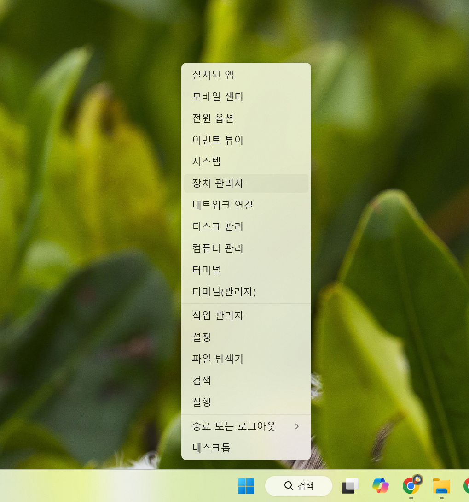

정상적으로 인식되면 아래와 비슷하게 표시됩니다.

```text
CP210x USB to UART Bridge (COM5)
USB Serial Device (COM3)
USB JTAG/serial debug unit (COM7)
CH340 USB-SERIAL (COM4)
```

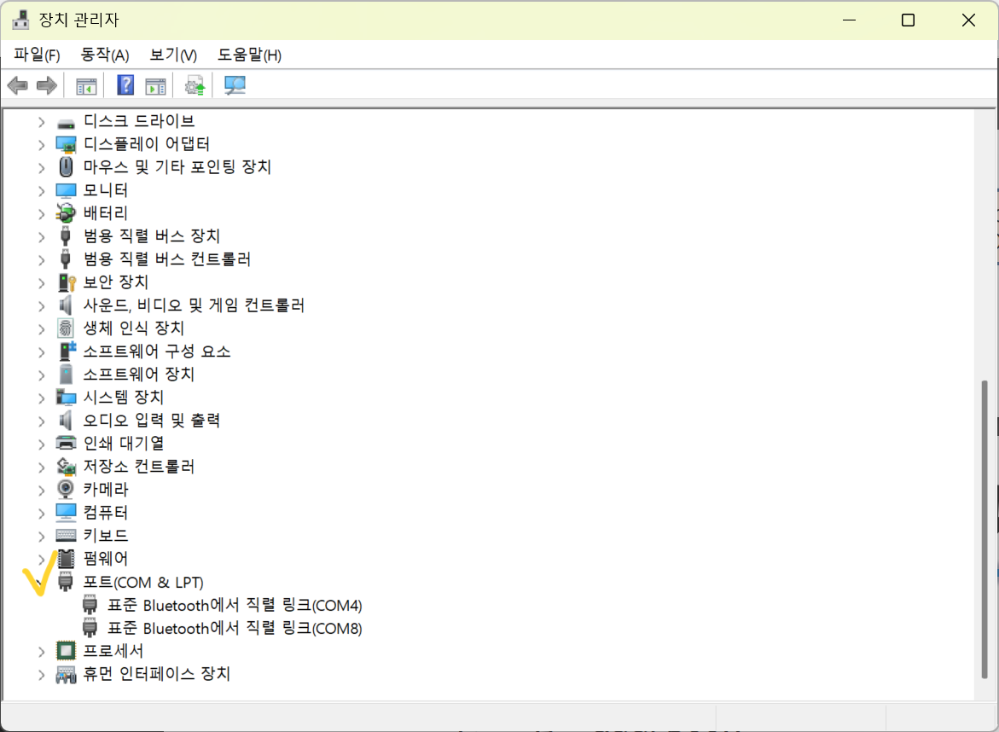

여기서 중요한 것은 COM5, COM3, COM7 같은 COM 번호입니다.

### 4. PlatformIO를 통해 프로젝트 생성하기

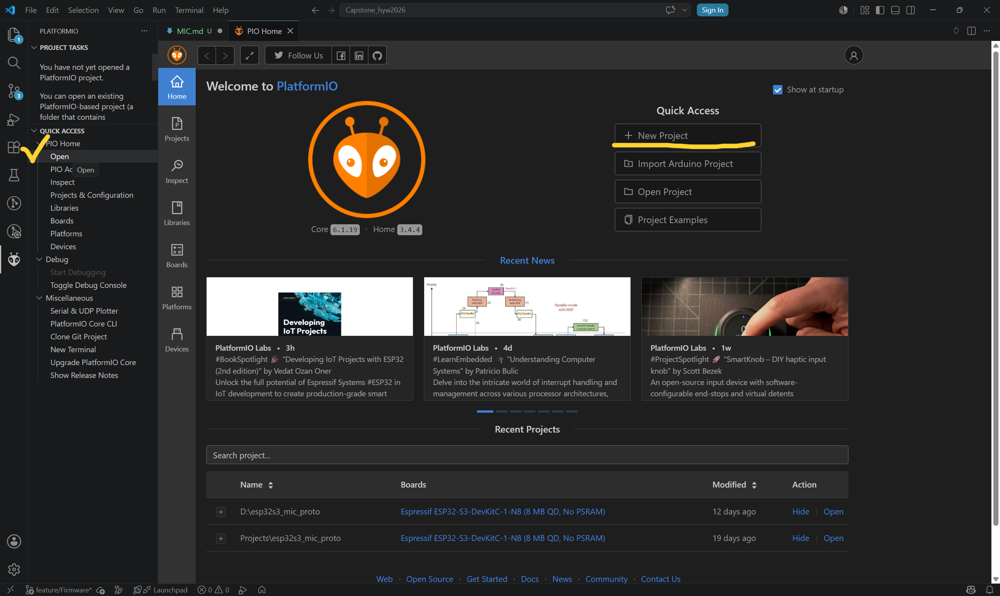

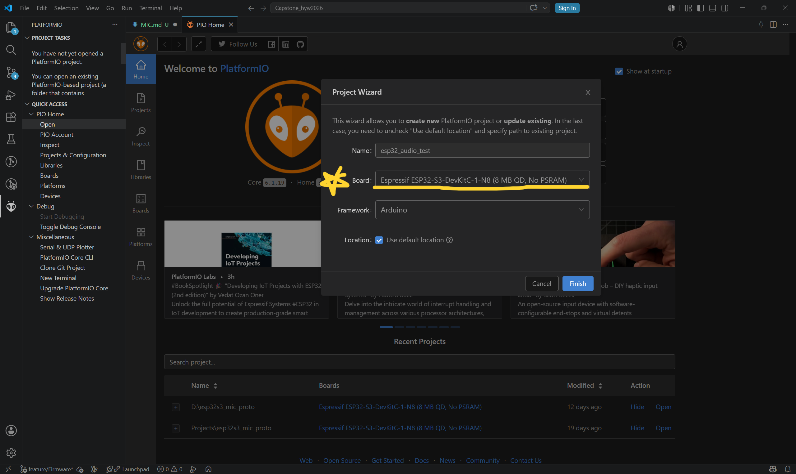

- 프로젝트 이름은 마음대로 작성
- board 선택이 중요한데, ESP32-S3의 경우에는 저 보드입니다. 다른 프로세서를 사용하시는 경우에는 체크해주세요.
- Framework는 Arduino로 사용합니다.

## 3. 프로젝트 파일 구조

```text
(제작한 프로젝트 이름)/
├─ platformio.ini (프로젝트 생성 시부터 존재. 내용 수정 필요)
├─ src/
│  └─ main.cpp (프로젝트 생성 시부터 존재. 내용 수정 필요)
├─ record_serial_wav.py (녹음된 파일을 저장하기 위한 소스코드. 만들어야 함.)
└─ recordings/ (녹음된 파일이 저장되는 로컬 저장소. 만들어야 함.)
   └─ 20260528_153012_mic_recording.wav (저장된 파일 예시)
```

1. platformio.ini: ESP32-S3 보드 종류, COM 포트, 업로드 속도, 시리얼 속도 등을 설정하는 파일.
2. src/main.cpp: ESP32-S3 안에 들어가는 펌웨어 코드. 마이크 값을 읽고 PC로 보내는 역할.
3. record_serial_wav.py: PC에서 실행하는 저장 프로그램. ESP32-S3가 보낸 오디오 데이터를 받아 WAV 파일로 저장.
4. recordings/: 실제 녹음 파일이 저장되는 폴더.

_저장하는 프로그램 소스 코드를 잘 모르고 파이썬을 짰는데, 너무 느려서 펌웨어 관련은 다 C로 작성하는 게 좋다고 하셨어요. 저도 수정할 예정입니다._

## 4. 회로 구성

마이크로 녹음만 받는 경우는 ESP32-S3와 마이크만 연결하면 되기 때문에 회로는 간단합니다.
저는 보호용으로 마이크와 ESP32-S3 사이 연결에 저항을 하나 추가 했습니다.

```
MAX4466 VCC  → ESP32-S3 3V3
MAX4466 GND  → ESP32-S3 GND
MAX4466 OUT → 1kΩ 저항 → ESP32-S3 GPIO4
```

> 펌웨어가 하는 일
```
1. ESP32-S3가 켜진다.
2. 마이크가 연결된 GPIO4 핀을 ADC 입력으로 설정한다.
3. PC에서 녹음 시작 명령 R을 보낼 때까지 기다린다.
4. R 명령을 받으면 5초 동안 마이크 값을 빠르게 읽는다.
5. 읽은 ADC 값을 오디오 샘플 값으로 변환한다.
6. 변환한 데이터를 USB Serial로 PC에 보낸다.
7. 전송이 끝나면 END 메시지를 보낸다.
```

> ADC 값을 WAV로 바꾸는 개념
```
1. 마이크가 직접 WAV 파일을 만들어주는 게 아님.
2. MAX4466은 그냥 소리에 따라 변하는 전압을 출력한다.
3. ESP32-S3가 이 전압을 아주 빠르게 반복해서 읽는다.
4. 예를 들어 1초에 8000번 읽으면 8000Hz 샘플링이 된다.
5. 이 숫자들을 일정한 형식으로 저장하면 WAV 파일이 된다.
```

## 5. 코드 작성

### platformio.ini 수정
```ini
[env:esp32-s3-devkitc-1]
platform = espressif32
board = esp32-s3-devkitc-1
framework = arduino

upload_port = COM9
monitor_port = COM9
monitor_speed = 921600

board_build.mcu = esp32s3
board_build.f_cpu = 240000000L
```

**upload_port와 monitor_port를 꼭 장치관리자에서 확인한 자신의 포트 연결 번호로 바꿔야한다.**


### main.cpp 수정
```cpp
#include <Arduino.h>

const int MIC_PIN = 4;
const int SAMPLE_RATE = 8000;
const int RECORD_SECONDS = 5;
const int TOTAL_SAMPLES = SAMPLE_RATE * RECORD_SECONDS;
const int SAMPLE_INTERVAL_US = 1000000 / SAMPLE_RATE;

const int GAIN = 30;

int calibrateCenter() {
  const int count = 1000;
  long sum = 0;

  for (int i = 0; i < count; i++) {
    sum += analogRead(MIC_PIN);
    delayMicroseconds(200);
  }

  return sum / count;
}

void setup() {
  Serial.begin(921600);

  analogReadResolution(12);
  analogSetPinAttenuation(MIC_PIN, ADC_11db);

  delay(1000);

  Serial.println("READY");
}

void loop() {
  if (Serial.available()) {
    char c = Serial.read();

    if (c == 'R') {
      int adcCenter = calibrateCenter() - 800;

      Serial.print("CENTER:");
      Serial.println(adcCenter);
      Serial.println("START");

      uint32_t nextMicros = micros();

      for (int i = 0; i < TOTAL_SAMPLES; i++) {
        while ((int32_t)(micros() - nextMicros) < 0) {
        }

        nextMicros += SAMPLE_INTERVAL_US;

        int raw = analogRead(MIC_PIN);
        int centered = raw - adcCenter;
        int sample16 = centered * GAIN;

        if (sample16 > 32767) sample16 = 32767;
        if (sample16 < -32768) sample16 = -32768;

        int16_t pcm = (int16_t)sample16;

        Serial.write((uint8_t *)&pcm, 2);
      }

      Serial.println();
      Serial.println("END");
    }
  }
}
```

- calibrateCenter()는 녹음 시작 전에 현재 무음 기준값을 자동으로 잡는 함수로
```cpp
const int ADC_CENTER = 2908;
```
이런식으로 기준값을 고정시켜도 괜찮다.


- 녹음 볼륨 조정
```cpp
const int GAIN = 24;
```
에서 숫자 조절.

숫자를 키우면 소리도 커지지만 노이즈도 커진다.


### record_serial_wav.py

**이 스크립트는 pyserial이 필요하다. 터미널에서 아래 명령어를 실행.**
```bash
pip install pyserial
```

**만약 pip가 안되면:**
```bash
python -m pip install pyserial
```

**여기서도 초반에 PORT = "COM9" 부분에 환경에 실제 포트와 맞는 번호를 입력해야 한다.**

```py
import serial
import wave
import os
import time
from datetime import datetime

PORT = "COM9"
BAUD = 921600
SAMPLE_RATE = 8000
RECORD_SECONDS = 5
TOTAL_BYTES = SAMPLE_RATE * RECORD_SECONDS * 2

os.makedirs("recordings", exist_ok=True)

timestamp = datetime.now().strftime("%Y%m%d_%H%M%S")
filename = os.path.join("recordings", f"{timestamp}_mic_recording.wav")

ser = serial.Serial(PORT, BAUD, timeout=5)
time.sleep(2)

ser.reset_input_buffer()

print("Waiting for ESP32-S3...")

ready_found = False
start_time = time.time()

while time.time() - start_time < 10:
    line = ser.readline().decode(errors="ignore").strip()
    if line:
        print("ESP:", line)
    if line == "READY":
        ready_found = True
        break

if not ready_found:
    print("READY message not found, but recording command will be sent.")

print("Start recording...")
ser.write(b"R")

start_found = False
start_time = time.time()

while time.time() - start_time < 10:
    line = ser.readline().decode(errors="ignore").strip()
    if line:
        print("ESP:", line)
    if line == "START":
        start_found = True
        break

if not start_found:
    ser.close()
    raise RuntimeError("START message not received from ESP32-S3.")

audio_data = bytearray()

while len(audio_data) < TOTAL_BYTES:
    chunk = ser.read(TOTAL_BYTES - len(audio_data))
    if not chunk:
        break
    audio_data.extend(chunk)
    print(f"Received {len(audio_data)} / {TOTAL_BYTES} bytes", end="\r")

print()
print("Recording received.")

if len(audio_data) != TOTAL_BYTES:
    print(f"Warning: expected {TOTAL_BYTES} bytes, received {len(audio_data)} bytes.")

with wave.open(filename, "wb") as wf:
    wf.setnchannels(1)
    wf.setsampwidth(2)
    wf.setframerate(SAMPLE_RATE)
    wf.writeframes(audio_data)

print(f"Saved: {filename}")

ser.close()
```
**python 소스 코드가 있는 폴더 내에 있는 저장소(폴더) recordings에 '오늘날짜_현재시간_mic_recording.wav'로 저장되는 코드이기 때문에 recordings 폴더가 필요합니다.**
**위에도 언급하였지만 펌웨어는 빠른 속도를 위해서 python이 아닌 C나 C++로 짜야합니다. 이건 어디까지나 프로토타입입니다.**

## 6. 실행 방법

> 빌드 => 업로드 => 시리얼 모니터 확인 => 시리얼 모니터 닫기 => 저장용 소스코드(record_serial_wav.py) 실행 => 실행 후 5초 동안 마이크에 대고 말하기 => recordings 폴더 안에 .wav 생성 확인 => WAV 파일을 재생해서 소리가 들리는지 확인

### 펌웨어 빌드

**PlatformIO 내에서 빌드하기**
```check
PROJECT TASKS > esp32dev > General > Build
```
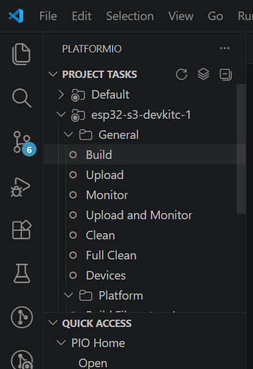

**프로젝트 코드를 보면서 빌드하기**
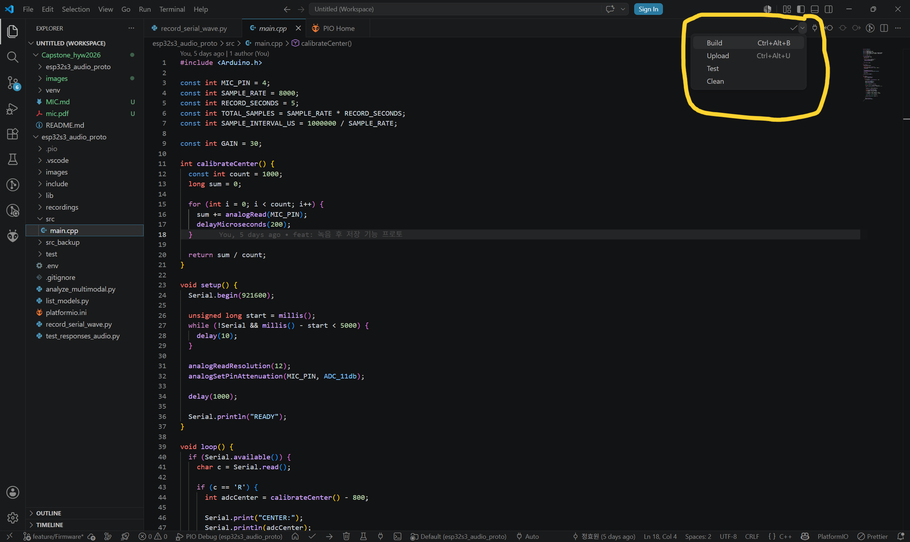

빌드가 성공하면 마지막에 SUCCESS가 표시됩니다.

### 펌웨어 업로드

보드를 USB로 연결한 상태에서 Upload를 실행합니다.

**PlatformIO 내에서 빌드하기**
```check
PROJECT TASKS > esp32dev > General > Build
```
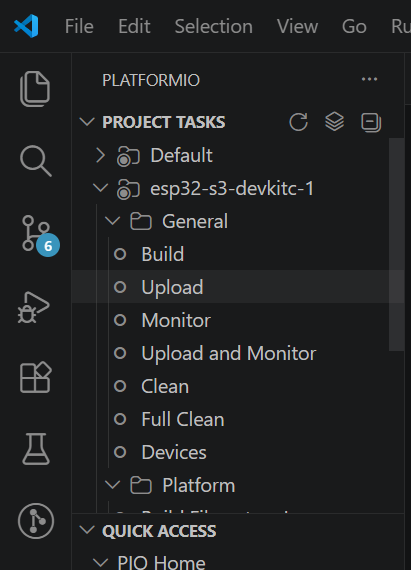

**프로젝트 코드를 보면서 빌드하기**
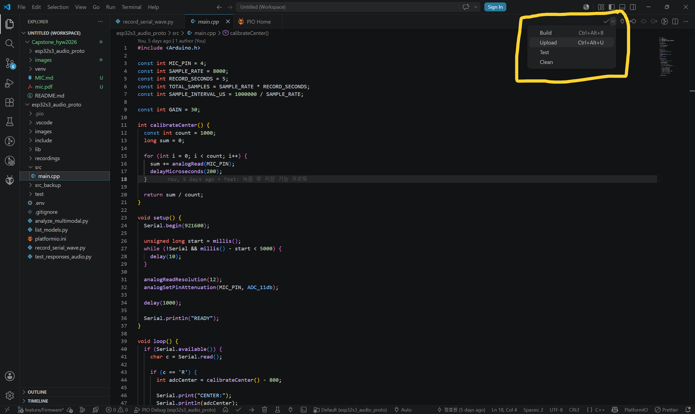

업로드는 빌드된 펌웨어를 실제 ESP32 보드에 넣는 과정입니다.

### 업로드가 안될 때

**업로드 중 아래 메시지에서 멈추면 보드가 업로드 모드로 자동 진입하지 못한 것입니다.**

```
Connecting........_____....._____.....
```

이 경우 다음 방법을 시도합니다.
1. Upload를 다시 실행합니다.
2. 터미널에 Connecting...이 보이면 보드의 BOOT 버튼을 누르고 유지합니다.
3. 업로드가 시작되면 BOOT 버튼에서 손을 뗍니다.

**시리얼이 안 보이거나 업로드 후 COM 포트 동작이 이상하면 playformio.ini에 아래 옵션을 추가합니다.**

```ini
build_flags =
    -DARDUINO_USB_CDC_ON_BOOT=1
    -DARDUINO_USB_MODE=1
```

```ini
[env:esp32-s3-devkitc-1]
platform = espressif32
board = esp32-s3-devkitc-1
framework = arduino

upload_port = COM9
monitor_port = COM9
monitor_speed = 921600

board_build.mcu = esp32s3
board_build.f_cpu = 240000000L

build_flags =
    -DARDUINO_USB_CDC_ON_BOOT=1
    -DARDUINO_USB_MODE=1
```

### 시리얼 모니터 확인

업로드가 끝난 뒤 시리얼 모니터를 실행합니다.

**PlatformIO 내에서**
```check
PROJECT TASKS > esp32dev > General > Monitor
```
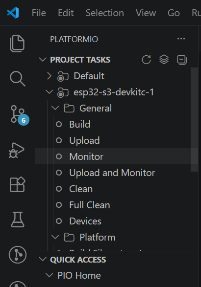

**프로젝트 코드를 보면서**
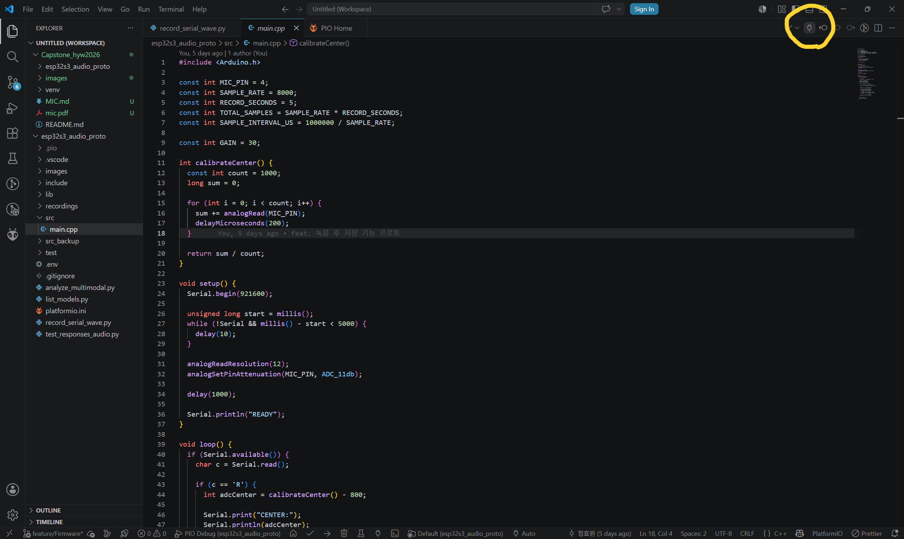

시리얼 모니터는 ESP32가 Serial.print()로 출력하는 값을 PC에서 확인하는 창입니다.

여기서는 초반에 CENTER, START 문구 외에는 딱히 실행되는 게 없고 시리얼 모니터를 늦게 열면 그 문구도 안보일 수도 있습니다.
저장용 소스코드 실행을 위해 시리얼 모니터가 꺼져 있어야하니 닫아줍니다. 그냥 터미널에서 지우면 됩니다.

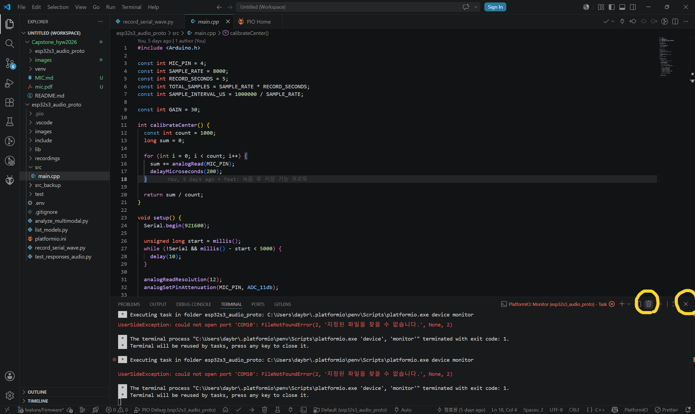

### record_serial_wave.py 실행

터미널에서 python record_serial_wav.py 해서 실행해도 되고, 그냥 VS Code에서 실행(Run)해도 됩니다.

정상으로 실행되면
```text
Waiting for ESP32-S3...
ESP: READY
Start recording...
Received 80000 / 80000 bytes
Recording received.
Saved: recordings\mic_recording.wav
```

Start recording... 이 나올 때 녹음하면 됩니다.

그러면 폴더에 다음 파일이 생깁니다.

```text
recordings/260000_000000_mic_recording.wav
```

**모르는 부분 있으시면 언제든 연락 주세요!**