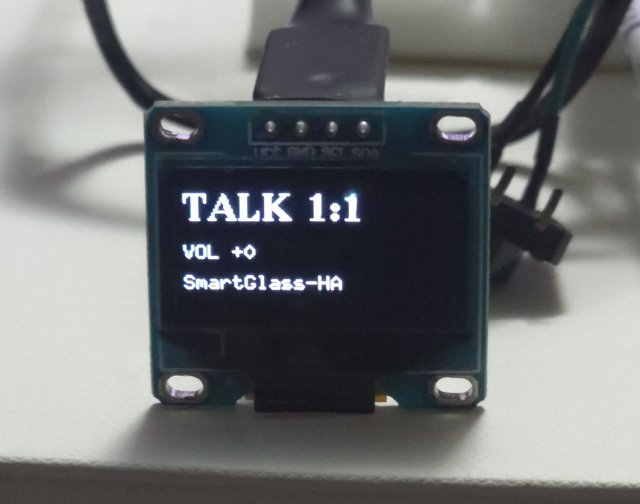
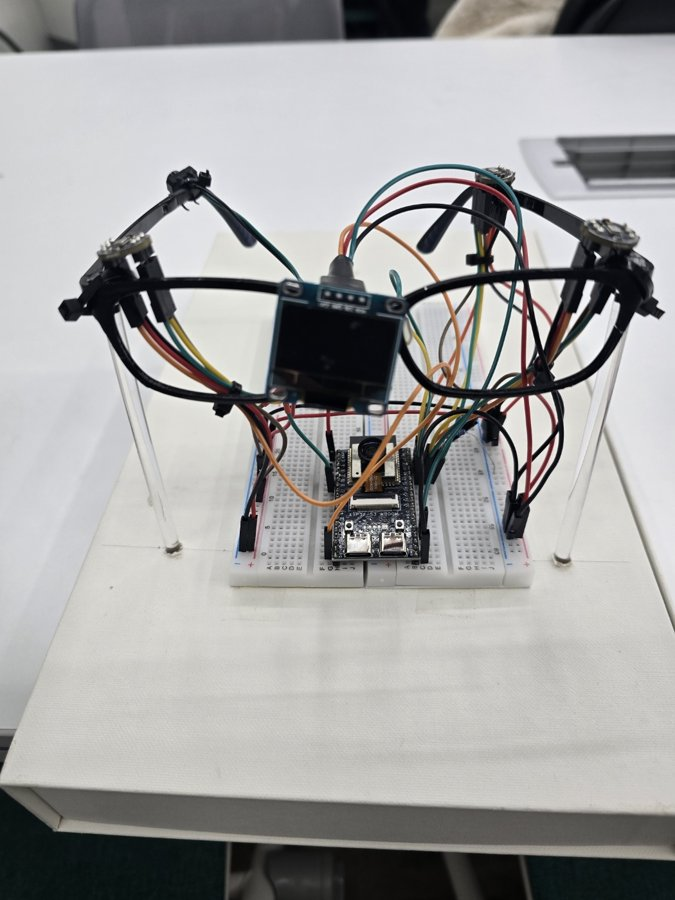

# 기능 1 · 상황을 읽어 모드를 바꾼다

> AI 스마트 안경형 보청기의 **기능별 정리 문서**입니다. 이 기능의 스펙, 최종 결과, 만든 과정을 모았습니다.
> 프로젝트 전체 소개와 대표 측정 결과는 [README](../../README.md)에 있습니다.
>
> **기능별 문서** · **1 상황 → 모드** · [2 빔포밍 소리](2-beamforming-sound.md) · [3 위험 방향 표시](3-danger-direction.md) · [4 음성 명령](4-voice-command.md)

| 모드 표시 (일대일 대화, 볼륨) | 시제품 |
|:---:|:---:|
|  |  |

## 한눈에

안경 카메라가 3초마다 찍은 사진과 마이크로 들은 소리를 스마트폰이 각각 AI로 분류합니다. 두 결과를 미리 정한 표로 합쳐([규칙 기반 결정 융합](#용어-풀이)) 듣기 모드 5종 중 하나를 고르고, 안경에 모드 변경 명령을 보냅니다.

**듣기 모드 5종**: 실내 기본 · 야외 기본 · TV 시청 · 일대일 대화 · 다인 대화

| 담당 | 맡은 일 |
|---|---|
| 최다현 | 이미지 상황 분류 모델 |
| 안호연 | 소리 상황 분류 모델 |
| 정효원 | 카메라 펌웨어, 스마트폰 앱 통합(두 모델 탑재, 모드 결정), 모델 평가 |

## 1. 스펙 (처음 정한 요구)

팀원이 쓴 원본 스펙 문서는 팀 내부 자료라 공개하지 않고, 핵심만 요약합니다.

**이미지 모델 스펙** (최다현, 2026-07)
- [MobileNetV2](#용어-풀이) 기반, 입력은 224×224 흑백 이미지
- 6클래스: 대화 · TV 시청 · 실내 · 야외 · 위험(가까운 차량·자전거 등) · negative(초점이 나갔거나 바닥·벽만 보이는 등 판단할 수 없는 사진)
- 클래스당 500~1,000장 목표. 공개 데이터 80% + 안경 카메라로 직접 찍은 사진 20%(추후)
- 출력 확률을 소리 결과와 합쳐 최종 판단

**소리 모델 스펙** (안호연, 2026-07)
- 스마트폰 안에서 도는 [온디바이스](#용어-풀이) 모델
- 4분류(대화 · 위험 · 일상 소음 · 무음) × 1,000개, AI Hub와 Kaggle(UrbanSound8K, ESC-50) 데이터
- 5초 이내 길이, 잡음 추가·속도 변환·음정 변환으로 데이터 늘리기

**시스템 쪽 요구** (정효원, 펌웨어·앱 설계)
- 안경은 사진(JPEG)을 2~5초마다(기본 3초), 소리는 16 kHz 모노 스트림으로 스마트폰에 보냅니다.
- 스마트폰 앱이 두 모델 결과를 표로 합쳐 `SET_MODE` 명령을 보내고, 안경은 받은 모드로 소리 처리와 OLED 화면을 바꿉니다.

**만들면서 달라진 점**
- 소리 모델은 4클래스에서 **3클래스(위험 · 소음 · 말소리)**로 바뀌었습니다. 무음은 앱이 소리 크기(RMS)로 따로 판정합니다.
- 소리 입력 길이는 5초에서 **2.0초**로 바뀌었습니다.
- 소리 스펙 원본은 스마트폰 마이크로 녹음하는 방식이었지만, 위험 소리와 방향을 묶기 위해 **안경 마이크 3개를 빔포밍한 소리**를 쓰기로 했습니다.
- 이미지 모델은 컬러 사진을 흑백으로 바꿔 학습했다는 것을 통합 단계에서 확인했습니다(2026-10-01). 그래서 앱과 카메라 입력도 흑백으로 맞췄습니다.

## 2. 최종 결과

### 모델

정확도와 측정 조건은 [README의 측정 결과](../../README.md#ai-모델)에 있습니다. 여기에는 모델 규격과 앱에서 처리하는 방법만 적습니다.

- 이미지 모델: `image_model/imageModel.tflite` (2.5 MB). 입력은 224×224×3, 0~255 값 그대로입니다(정규화가 모델 안에 들어 있음). 흑백 사진을 3채널로 복제해 넣습니다.
- 이미지 후처리(최다현 `camera.py`를 앱으로 옮김): negative 확신도가 0.95보다 낮으면 2순위 클래스를 쓰고, 최근 3장의 다수결로 결과를 안정시킵니다.
- 소리 모델: `sound_model/` ([Edge Impulse](#용어-풀이) 배포본 v5). 2.0초(32,000샘플) 창을 [MFE](#용어-풀이) 특징으로 바꿔 [CNN](#용어-풀이)이 분류합니다. INT8 양자화 모델은 490 KB입니다.

### 스마트폰 앱의 모드 결정 (`ModeController.kt`)

우선순위는 **통화 감지 > 수동 명령(앱 버튼·음성 명령, 30초 유지) > 자동 판단**입니다. 자동 판단은 아래 표를 따릅니다.

| 이미지 판정 | 소리 판정 | 결과 |
|---|---|---|
| 대화 | 무음 | 실내 기본 |
| 대화 | 소리 있음 | 일대일 대화 또는 다인 대화 — 최근 소리가 온 방향이 2곳 이상이면 다인 대화 ([방향 히스토그램](#용어-풀이)) |
| TV 시청 | (무관) | TV 시청 |
| 실내 | 말소리 | 일대일 대화 |
| 실내 | 그 밖 | 실내 기본 |
| 야외 | (무관) | 야외 기본 |
| negative | 말소리 | 일대일 대화 |
| negative | 그 밖 | 지금 모드 유지 |
| 위험 | (무관) | 모드는 그대로 두고 OLED 위험 알림, 자동 모드일 때 ([기능 3](3-danger-direction.md)) |

- 사진은 3초마다, 소리는 2초 단위로 분류합니다. 소리 결과는 5초 안의 값만 씁니다.
- 일대일과 다인을 구분하는 신호는 두 모델 어디에도 없어서, 안경이 소리에 함께 보내는 방향 정보로 나눴습니다.

### 안경 쪽 (카메라·화면)

- OV2640 카메라: VGA(640×480) JPEG 한 장이 23~24 KB, 촬영에 85~125 ms. 해상도(VGA/QVGA)·압축률·흑백 전송을 시리얼 명령으로 바꿀 수 있습니다.
- OLED 화면: 현재 모드, 볼륨, 음성 명령 버튼 상태를 표시합니다.

### 아직 측정하지 않은 것

- 스마트폰 실기기에서의 분류 정확도
- 이미지와 소리를 함께 볼 때와 하나만 볼 때의 비교(융합 효과)

## 3. 만든 과정

| 날짜 | 누가 | 한 일 | 자료 |
|---|---|---|---|
| 2026-05-06 | 최다현 | 스마트폰 앱이 녹음한 음성을 서버(FastAPI)로 보내고, 서버가 Whisper로 음성인식하는 첫 구조 | [`archive/2026-05-app-fastapi-whisper`](https://github.com/hy0w0n/context-aware-hearing-glasses/tree/archive/2026-05-app-fastapi-whisper) |
| 2026-05-11 | 최다현 | 서버에서 Gemini로 음성인식과 상황 분석 | [`archive/2026-05-app-fastapi-gemini`](https://github.com/hy0w0n/context-aware-hearing-glasses/tree/archive/2026-05-app-fastapi-gemini) |
| 2026-05-28 | 최다현 | 티처블머신으로 학습한 모델로 이미지 상황 판단 | [`archive/2026-05-image-teachable-machine`](https://github.com/hy0w0n/context-aware-hearing-glasses/tree/archive/2026-05-image-teachable-machine) |
| 2026-06-06 | 안호연 | YAMNet 특징 위에 작은 분류층을 얹은 소리 인식 테스트 서버 | [`archive/2026-06-sound-learning-app`](https://github.com/hy0w0n/context-aware-hearing-glasses/tree/archive/2026-06-sound-learning-app) |
| 2026-07 | 최다현 · 안호연 | 이미지·소리 모델 스펙 작성 → 전체 구조를 "AI는 스마트폰 안에서"로 재설계 | (위 1절 요약) |
| 2026-07-23 | 안호연 | Edge Impulse로 만든 소리 분류 안드로이드 앱 | [`archive/2026-07-sound-edge-impulse-app`](https://github.com/hy0w0n/context-aware-hearing-glasses/tree/archive/2026-07-sound-edge-impulse-app) |
| 2026-08-11 | 정효원 | 카메라 촬영·이미지 전송, OLED 모드 화면, PC 제어 도구 | `firmware/src/camera_test.*`, `img_link.*`, `ui_oled.*`, `tools/` |
| 2026-08-15 | 최다현 | MobileNetV2 이미지 분류 모델과 시연 코드 | `image_model/` |
| 2026-09-10 | 정효원 | 앱에 이미지 분류 탑재(통합 1단계), 모드 결정기 추가(통합 3단계) | `ImageClassifier.kt` |
| 2026-09-17 | 안호연 | 소리 분류 모델 배포본 v5 | `sound_model/` |
| 2026-10-01 | 정효원 | 앱에 소리 분류 탑재(통합 4단계) → 이미지와 소리를 함께 판단. 흑백 학습 확인 후 앱·카메라 입력을 흑백으로 | `SoundClassifier.kt`, `ModeController.kt` |
| 2026-10-03 | 정효원 | 소리 전처리 오류 수정, 학습에 쓰지 않은 웹 이미지 65장으로 따로 평가 | `tools/*_eval.py`, `docs/` |
| 2026-10-07 | 정효원 | 모델 성능 확보 방안 정리 | `docs/모델_성능_확보_가이드.md` |

**통합하면서 맞추고 고친 것**
- **이미지 입력 규격**: 모델 안에 정규화가 들어 있는 것을 확인하고 0~255 값을 그대로 넣었습니다. 앱에서 한 번 더 정규화하면 이중 전처리가 되어 결과가 망가집니다.
- **색공간 불일치**: 모델은 흑백으로 학습됐는데 앱은 컬러를 넣고 있었습니다. 다현 님 확인 후 앱·카메라·`camera.py`를 흑백 입력으로 바꿨습니다(원래 컬러판은 `camera_color_backup.py`).
- **소리 전처리 누락**: Edge Impulse는 특징을 뽑기 전에 프리엠퍼시스(고음 강조)를 하고 값을 32768로 나눕니다. 앱 포팅에서 이 두 단계가 빠져, 입력과 관계없이 '위험'이 나왔습니다(파이썬으로 재현해 확인). 두 단계를 넣고, 학습 데이터처럼 2초 창마다 최대 크기를 맞추는 정규화도 더했습니다.

## 4. 관련 파일

| 경로 | 내용 |
|---|---|
| [`image_model/`](../../image_model/) | 이미지 분류 모델(`imageModel.tflite`)과 PC 시연 코드(`camera.py`, 흑백 입력. 원래 컬러판은 `camera_color_backup.py`) |
| [`sound_model/`](../../sound_model/) | 소리 분류 모델(Edge Impulse 배포본 v5). SDK 전체는 용량 때문에 빼고, 원본 zip은 [`archive/2026-09-sound-model-v5`](https://github.com/hy0w0n/context-aware-hearing-glasses/tree/archive/2026-09-sound-model-v5)에 있습니다 |
| [`android/…/ImageClassifier.kt`](../../android/app/src/main/java/com/smartglass/test/ImageClassifier.kt) | 이미지 분류, 후처리(negative 규칙, 3장 다수결) |
| [`android/…/SoundClassifier.kt`](../../android/app/src/main/java/com/smartglass/test/SoundClassifier.kt) | MFE 특징 추출 포팅, 2초 창 소리 분류, 무음 판정 |
| [`android/…/ModeController.kt`](../../android/app/src/main/java/com/smartglass/test/ModeController.kt) | 모드 결정(우선순위, 이미지×소리 표, 일대일/다인 구분) |
| [`firmware/src/camera_test.cpp`](../../firmware/src/camera_test.cpp) | 카메라 촬영, 해상도·압축률·흑백 전환 |
| [`firmware/src/img_link.cpp`](../../firmware/src/img_link.cpp) | WiFi 이미지 전송과 명령 처리 |
| [`firmware/src/ui_oled.cpp`](../../firmware/src/ui_oled.cpp) | OLED 화면(모드·볼륨·PTT 표시) |
| [`tools/image_eval.py`](../../tools/image_eval.py) | 이미지 모델 독립 평가 |
| [`tools/sound_eval.py`](../../tools/sound_eval.py) | 소리 모델 평가 |
| [`tools/audio_pipeline_eval.py`](../../tools/audio_pipeline_eval.py) | 전처리·압축·패킷 손실이 소리 판정에 미치는 영향 시뮬레이션 |
| [`docs/모델_의사결정기록.md`](../../docs/모델_의사결정기록.md) | 모델 관련 결정 기록 |
| [`docs/이미지_독립평가_웹.md`](../../docs/이미지_독립평가_웹.md) | 이미지 독립 평가 결과 |
| [`docs/오디오_전처리_전송_영향.md`](../../docs/오디오_전처리_전송_영향.md) | 오디오 전처리·전송 영향 |
| [`docs/모델_성능_확보_가이드.md`](../../docs/모델_성능_확보_가이드.md) | 모델 성능 확보 방안 |

## 5. 다음 과제

- 안경 카메라와 마이크로 모은 데이터로 두 모델을 다시 학습하고 다시 평가
- TV·위험 장면 이미지 보강
- 스마트폰 실기기에서 정확도와 융합 효과 측정

## 용어 풀이

| 용어 | 뜻 |
|---|---|
| **규칙 기반 결정 융합** (late fusion) | 이미지 모델과 소리 모델이 각자 결론을 낸 뒤, 미리 정한 표로 최종 모드를 정하는 방식입니다. |
| **MobileNetV2** | 스마트폰처럼 가벼운 기기에서도 빠르게 돌도록 설계된 이미지 분류 신경망입니다. |
| **온디바이스 AI** | 데이터를 서버로 보내지 않고 스마트폰 안에서 직접 AI 계산을 하는 것입니다. |
| **Edge Impulse · MFE · CNN** | Edge Impulse는 소형 기기용 AI 모델을 만드는 플랫폼입니다. MFE(Mel-filterbank Energy)는 소리를 사람 귀의 주파수 감각에 맞춘 대역별 에너지로 바꾼 특징이고, CNN은 그 특징을 그림처럼 보고 분류하는 신경망입니다. |
| **float32 · INT8** | 모델 안의 숫자를 저장하는 정밀도입니다. INT8로 줄이면(양자화) 모델이 작아지고 빨라지지만 결과가 조금 달라질 수 있습니다. |
| **방향 히스토그램** | 안경이 최근 몇 초 동안 소리가 온 방향을 8칸으로 나눠 센 값입니다. 소리 데이터와 함께 스마트폰으로 보냅니다. |

## 커밋 이력

이 기능의 커밋은 [PR #1](https://github.com/hy0w0n/context-aware-hearing-glasses/pull/1)로 main에 합쳤습니다(2026-11-09 정리).

- **5~7월 초기 시제품**: `archive/*` 태그의 원래 커밋을 날짜·작성자·메시지 그대로 옮겼습니다. 커밋 본문에 원본 커밋 번호가 있습니다. 시제품 파일 자체는 main에 두지 않았으니 위 표의 태그에서 보세요.
- **7~11월 작업**: 이 시기에는 git으로 관리하지 않았습니다. 그래서 남아 있는 파일 버전(2026-10-01 백업과 최종본)을 **각 파일을 마지막으로 고친 시각과 만든 사람**으로 커밋했습니다. 같은 파일의 중간 버전은 남아 있지 않아서, 커밋 하나가 그날 작업 전체를 뜻하지는 않습니다.
- **이 문서**는 정효원이 2026-11-09에 썼습니다.
