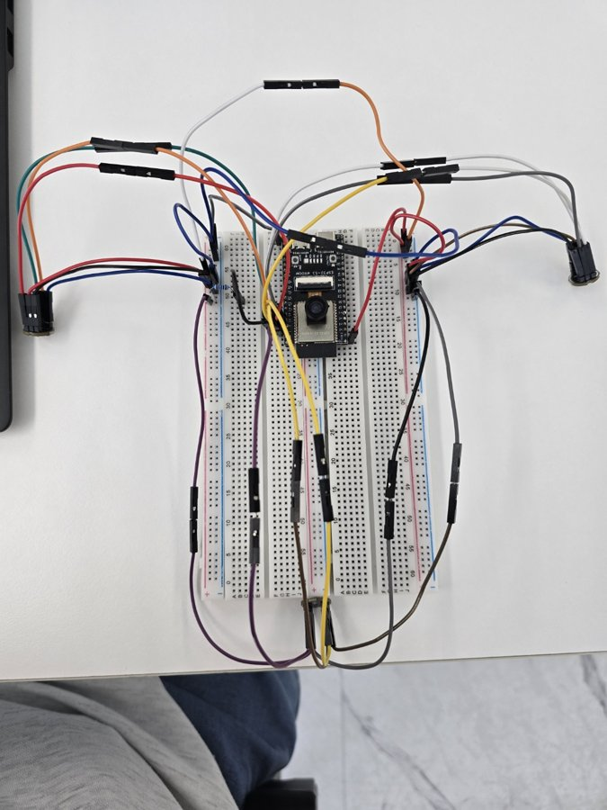
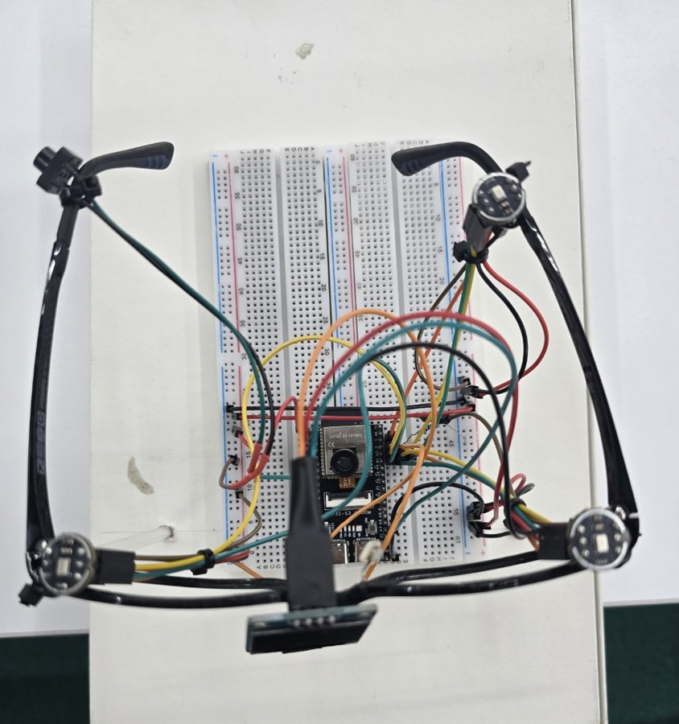

# 기능 2 · 모드에 맞게 다듬은 소리

> AI 스마트 안경형 보청기의 **기능별 정리 문서**입니다. 이 기능의 스펙, 최종 결과, 만든 과정을 모았습니다.
> 프로젝트 전체 소개와 대표 측정 결과는 [README](../../README.md)에 있습니다.
>
> **기능별 문서** · [1 상황 → 모드](1-situation-mode.md) · **2 빔포밍 소리** · [3 위험 방향 표시](3-danger-direction.md) · [4 음성 명령](4-voice-command.md)

| 8월 · 브레드보드 배선 | 위에서 본 시제품 (아래쪽이 안경 앞면) |
|:---:|:---:|
|  |  |

## 한눈에

안경의 디지털 마이크 3개로 소리를 동시에 녹음하고, [빔포밍](#용어-풀이)으로 합쳐 원하는 방향의 소리를 키웁니다. 모드마다 빔 모양과 저음 차단 정도를 바꾸고, 16 kHz 모노로 줄여 [ADPCM](#용어-풀이)으로 압축한 뒤 [BLE](#용어-풀이)로 스마트폰에 보냅니다. 이 소리는 기능 1의 소리 분류에 쓰입니다. 이어폰 출력은 [DAC](#용어-풀이)를 확보해 구현 중입니다.

| 담당 | 맡은 일 |
|---|---|
| 정효원 | 마이크·오디오 펌웨어, 빔포밍, 압축·전송, PC 검증 도구, 앱 수신부 |

## 1. 스펙 (처음 정한 요구)

**펌웨어 스펙** (정효원, 2026-07, `docs/정효원_펌웨어 스펙.html`)
- ESP32-S3 두 코어를 나눠 씀: 하나는 통신, 하나는 마이크·카메라·버튼
- 소리는 녹음해 모았다가 보내지 않고, 20~50 ms 조각으로 바로바로 보냄(16 kHz, 16비트, 모노). 보청기는 지연이 크면 쓸 수 없기 때문
- 처음 구조는 스마트폰 앱이 소리를 다듬어 안경으로 돌려보내는 왕복 방식(목표 100 ms 이내)
- 3단계 검증: ① 시리얼로 파형 확인 → ② PC에서 WAV로 저장해 직접 들어 보기 → ③ 패킷 순번으로 빠진 패킷 세기

**설계를 확정하며 바꾼 점** (2026-07-27~28)
- **48 kHz × 3채널로 녹음**: 방향 추정에서 마이크 사이 시간 차이를 더 잘게 재기 위해서입니다. 빔포밍 뒤에 16 kHz로 줄입니다.
- **마이크 3개 동시 녹음**: INMP441은 [I2S](#용어-풀이) 버스 하나에 2개까지만 달 수 있습니다. 그래서 2개 + 1개로 버스를 나누고, 두 버스가 같은 클럭을 쓰게 해 샘플 시점을 맞춥니다.
- **제품 통신은 BLE**: 공유기·인터넷 없이 스마트폰과 직접 연결합니다. 같은 펌웨어를 WiFi로도 빌드할 수 있게 해서 비교 실험과 디버깅에 씁니다.
- **ADPCM 4:1 압축**: 원본(PCM) 그대로는 BLE 여유가 부족하다고 판단했습니다.
- **소리 출력은 안경 안에서**: 스마트폰을 거쳐 돌아오는 왕복은 지연과 자기 목소리 메아리 때문에 착용감이 나쁩니다. 그래서 안경에서 바로 이어폰으로 내보내는 구조로 바꿨습니다(목표 20 ms 이하). 처음 고른 앰프(MAX98357A)는 이어폰에 직접 물리면 안 되는 스피커용이라 DAC(PCM5102A)로 바꿨습니다.

## 2. 최종 결과

### 소리 처리 흐름

```
마이크 ×3 (48 kHz) ─▶ 3채널 정렬 ─▶ 빔포밍(지연 맞춤 + 가중 합) ─▶ 120 Hz 저음 차단
   ─▶ 3:1 줄이기(33탭 FIR) ─▶ 16 kHz 모노 + 방향 정보 ─▶ ADPCM 압축 ─▶ BLE / WiFi
```

- 두 I2S 버스를 같은 클럭으로 묶어 3채널을 동시에 녹음합니다(I2S0 마스터 + I2S1 슬레이브).
- 120 Hz 저음 차단은 실제로 들어 보고 넣었습니다. 빔포밍 결과에서 마이크를 만질 때의 진동이나 느린 흔들림 같은 0~100 Hz 성분이 다른 대역보다 18~30 dB 컸고, 넣은 뒤 그 대역이 26 dB 줄었습니다.
- 소리 패킷마다 방위각·신뢰도·8방향 히스토그램을 함께 실어 보냅니다(기능 1의 일대일/다인 구분, 기능 3의 화살표에 씀).

### 모드별 소리 처리 (프리셋 5종)

| 모드 | 빔 | 저음 차단 |
|---|---|---|
| 실내 기본 | 광폭(세 마이크 같은 비중) | 120 Hz |
| 야외 기본 | 광폭 | 300 Hz (바람·차 소음 줄이기) |
| TV 시청 | 앞쪽 두 마이크 위주 (0.45 / 0.45 / 0.10) | 150 Hz |
| 일대일 대화 | 앞쪽 좁은 빔 (0.4 / 0.4 / 0.2) | 150 Hz |
| 다인 대화 | 일대일과 같은 빔을 소리가 오는 방향으로 돌림 (방향 신뢰도 80 이상일 때, 20° 넘게 바뀌면 따라감) | 150 Hz |

지연·가중값은 2026-09-10의 이전 마이크 배치(14 cm 정삼각형) 기준입니다. 지금 배치(앞쪽 양옆 2개 + 왼쪽 안경다리 끝 1개)에 맞춘 값은 아직 다시 재지 않았습니다.

### 전송 측정

PCM과 ADPCM의 손실률·사진 전송 시간 비교, 압축 후 분류 일치율은 [README의 측정 결과](../../README.md#블루투스-오디오-전송)에 있습니다. 여기에는 그 밖의 측정만 적습니다.

| 결과 | 조건 |
|---|---|
| WiFi 1채널 48 kHz 원본 스트리밍 **손실 0/989 패킷** | 2026-07-28, PC 수신 10초 |
| WiFi 3채널 48 kHz 스트리밍 손실 **0~0.11%** | 2026-08-11, 핫스팟 연결, PC 수신 |
| BLE 연결 간격을 7.5~15 ms로 줄여 오디오 손실 **3.5% → 1.1%** | 2026-08-25, 오디오만, PC 수신 |

- BLE 수신은 PC(BLE 동글)에서 했고, 조건마다 1~2회 측정했습니다.
- ADPCM은 압축 후 되살렸을 때 원음 대비 SNR 26.8 dB였습니다. 패킷마다 디코더 상태를 함께 실어서 중간에 패킷이 빠져도 다음 패킷부터 바로 복구됩니다.
- 갤럭시 S24 Ultra에서도 ADPCM 소리를 받아 파형을 그리는 것까지 확인했습니다(손실률은 미측정).

### 아직 하지 않은 것

- **이어폰 출력**: DAC(PCM5102A)를 받았고(2026-11) 연결과 구현을 진행 중입니다. 출력 지연은 아직 재지 않았습니다.
- BLE와 WiFi의 처리량·지연·전력 비교 실험 전체

## 3. 만든 과정

| 날짜 | 누가 | 한 일 | 자료 |
|---|---|---|---|
| 2026-05 | 정효원 | ESP32-S3 첫 펌웨어: 보드 점검, 아날로그 마이크(MAX4466) 입력 읽기 | [`archive/2026-05-firmware-mic-proto`](https://github.com/hy0w0n/context-aware-hearing-glasses/tree/archive/2026-05-firmware-mic-proto) |
| 2026-05-28 ~ 06-02 | 정효원 | 아날로그 마이크 녹음을 PC에서 WAV로 저장하는 시제품과 사용법 | [`archive/2026-06-firmware-max4466-recording`](https://github.com/hy0w0n/context-aware-hearing-glasses/tree/archive/2026-06-firmware-max4466-recording) |
| 2026-07 | 정효원 | 펌웨어 스펙 작성 → 7월 27~28일 전체 설계 확정 | `docs/정효원_펌웨어 스펙.html` |
| 2026-07-28 | 정효원 | 새 펌웨어(PlatformIO) 시작. 디지털 마이크 1개 → 2개 → 3개, 두 버스 클럭 공유 성공. WiFi 손실 0%, BLE 첫 전송 | `firmware/platformio.ini`, `audio_capture.h`, `tools/` |
| 2026-08-11 | 정효원 | 마이크 케이블 직결로 다시 배선, 3채널 스트리밍 확인 | `audio_capture.cpp`, `log_util.*` |
| 2026-08-25 | 정효원 | BLE 연결 간격 조정, 앱에 WiFi 수신·파형 표시 | `WifiLink.kt`, `WaveformView.kt` |
| 2026-09-10 | 정효원 | 빔포밍·저음 차단·3:1 줄이기를 펌웨어(C)로 옮김, ADPCM 압축, BLE에서 PCM과 ADPCM 교차 측정, 모드 프리셋 5종 | `dsp_pipeline.*`, `adpcm.*`, `proto_frame.*`, `ble_link.*` |
| 2026-09-14 | 정효원 | 배선 가이드 v3 | `docs/SmartGlass_배선가이드_v3.pdf` |
| 2026-10-01 | 정효원 | 앱 BLE 수신부와 펌웨어 메인 루프 갱신 | `BleLink.kt`, `main.cpp` |
| 2026-11 | 정효원 | 이어폰 출력용 DAC 확보, 구현 착수 | (구현 중) |

**만들면서 해결한 문제**
- **두 I2S 버스 클럭 공유**: 슬레이브 버스를 먼저, 마스터 버스를 나중에 초기화해야 공유 핀의 클럭 출력이 끊기지 않았습니다. 두 번 실패한 뒤 찾은 순서입니다.
- **버스 사이 시점 차이**: 두 버스 사이에 1샘플 어긋남이 생기는 날과 없는 날이 있어(07-28 +1샘플, 09-10 0샘플), 부팅할 때마다 맞추는 보정이 필요하다는 것을 확인했습니다.
- **24비트를 16비트로 줄일 때 소리가 너무 작아짐**: 위쪽 비트만 잘라내면 쓸 만한 비트가 부족했습니다. 8배 키운 뒤 넘치는 값만 잘라내도록 바꿨습니다.
- **BLE 손실**: 같은 PC에서 켜 둔 2.4 GHz 핫스팟이 BLE를 방해했습니다. 원본(PCM)은 이때 크게 끊겼지만 ADPCM은 거의 끊기지 않았습니다.

## 4. 관련 파일

| 경로 | 내용 |
|---|---|
| [`firmware/src/audio_capture.cpp`](../../firmware/src/audio_capture.cpp) | 마이크 3개 동시 녹음(I2S 두 버스, 클럭 공유) |
| [`firmware/src/dsp_pipeline.cpp`](../../firmware/src/dsp_pipeline.cpp) | 빔포밍, 저음 차단, 3:1 줄이기, 모드 프리셋 (방향 추정 부분은 기능 3) |
| [`firmware/src/adpcm.cpp`](../../firmware/src/adpcm.cpp) | IMA ADPCM 압축 |
| [`firmware/src/proto_frame.cpp`](../../firmware/src/proto_frame.cpp) | 통신 프레임 |
| [`firmware/src/ble_link.cpp`](../../firmware/src/ble_link.cpp) | BLE 전송 |
| [`firmware/src/wifi_link.cpp`](../../firmware/src/wifi_link.cpp) | WiFi 전송 (실험·디버깅용) |
| [`firmware/src/config.h`](../../firmware/src/config.h) | 핀·마이크 위치 설정 |
| [`firmware/platformio.ini`](../../firmware/platformio.ini) | 빌드 설정 (env:ble / env:wifi) |
| [`android/…/BleLink.kt`](../../android/app/src/main/java/com/smartglass/test/BleLink.kt) | 앱 BLE 수신 |
| [`android/…/Proto.kt`](../../android/app/src/main/java/com/smartglass/test/Proto.kt) | 앱 프레임 해석, ADPCM 복원 |
| [`android/…/WaveformView.kt`](../../android/app/src/main/java/com/smartglass/test/WaveformView.kt) | 앱 파형 표시 |
| [`tools/receiver.py`](../../tools/receiver.py) | PC WiFi 수신 → WAV 저장, 손실 통계 |
| [`tools/ble_receiver.py`](../../tools/ble_receiver.py) | PC BLE 수신 |
| [`tools/listen_live.cpp`](../../tools/listen_live.cpp) | PC 실시간 청취 |
| [`tools/beamform_prototype.py`](../../tools/beamform_prototype.py) | 빔포밍 파이썬 시제품 |
| [`docs/정효원_펌웨어 스펙.html`](../../docs/정효원_펌웨어 스펙.html) | 펌웨어 스펙 |
| [`docs/SmartGlass_배선가이드_v3.pdf`](../../docs/SmartGlass_배선가이드_v3.pdf) | 배선 가이드 |

## 5. 다음 과제

- DAC 연결, 이어폰 출력, 출력 지연 측정
- 바뀐 마이크 배치에 맞춰 마이크 좌표와 빔포밍 지연·가중값 다시 정하기
- BLE·WiFi 비교 실험(처리량·지연·전력)

## 용어 풀이

| 용어 | 뜻 |
|---|---|
| **빔포밍** (delay-and-sum) | 마이크마다 소리가 도착한 시각이 조금씩 다른데, 그 차이를 맞춰서 더하는 기법입니다. 원하는 방향의 소리는 커지고, 다른 방향의 소리는 상대적으로 작아집니다. |
| **샘플링 주파수** (48 kHz / 16 kHz) | 1초에 소리를 몇 번 측정하는지입니다. 방향 추정은 아주 작은 시간 차이를 재야 해서 48 kHz로 녹음하고, 분류에는 16 kHz면 충분해 줄여서 보냅니다. |
| **FIR 필터 · 3:1 줄이기** | 48 kHz를 16 kHz로 줄이기 전에 높은 주파수를 걸러 소리가 뭉개지지 않게 하는 필터입니다. |
| **ADPCM** (IMA ADPCM, 4:1) | 소리 샘플 하나를 16비트에서 4비트로 줄이는 간단한 압축입니다. 계산이 가벼워 안경의 작은 칩에서도 실시간으로 돕니다. |
| **BLE 5.0** | 저전력 블루투스(Bluetooth Low Energy)입니다. 스마트폰과 직접 연결하므로 공유기나 인터넷이 필요 없습니다. |
| **패킷 손실률** | 보낸 데이터 묶음(패킷) 중 도착하지 못한 비율입니다. 순번이 비는 곳을 세서 구합니다. |
| **I2S** | 칩과 디지털 오디오 부품(마이크, DAC)을 잇는 통신 방식입니다. |
| **DAC** | 디지털 소리 데이터를 이어폰이 재생할 수 있는 아날로그 신호로 바꾸는 부품입니다. |
| **SNR** | 원래 신호 대비 잡음(여기서는 압축 오차)의 크기입니다. 클수록 원음에 가깝습니다. |

## 커밋 이력

이 기능의 커밋은 [PR #2](https://github.com/hy0w0n/context-aware-hearing-glasses/pull/2)로 main에 합쳤습니다(2026-11-09 정리).

- **5~7월 초기 시제품**: `archive/*` 태그의 원래 커밋을 날짜·작성자·메시지 그대로 옮겼습니다. 커밋 본문에 원본 커밋 번호가 있습니다. 시제품 파일 자체는 main에 두지 않았으니 위 표의 태그에서 보세요.
- **7~11월 작업**: 이 시기에는 git으로 관리하지 않았습니다. 그래서 남아 있는 파일 버전(2026-10-01 백업과 최종본)을 **각 파일을 마지막으로 고친 시각과 만든 사람**으로 커밋했습니다. 같은 파일의 중간 버전은 남아 있지 않아서, 커밋 하나가 그날 작업 전체를 뜻하지는 않습니다.
- **이 문서**는 정효원이 2026-11-09에 썼습니다.
