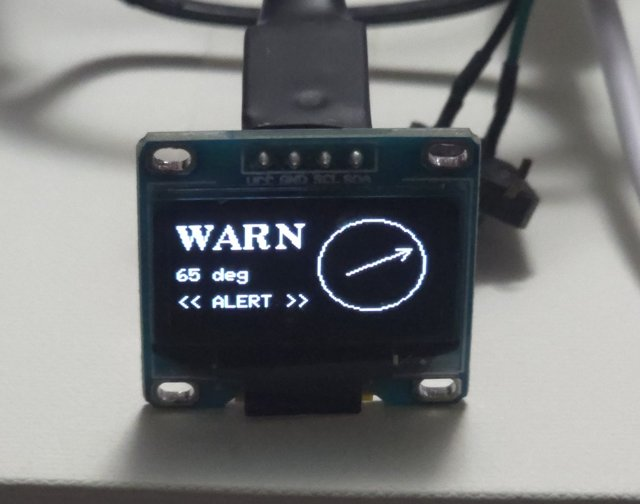
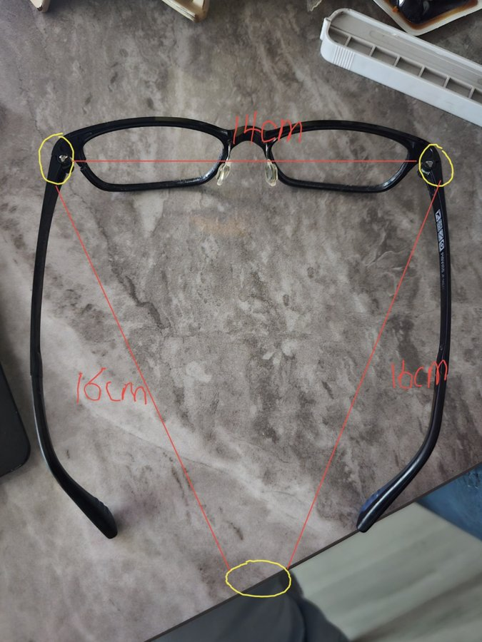

# 기능 3 · 시야 밖 위험의 방향 표시

> AI 스마트 안경형 보청기의 **기능별 정리 문서**입니다. 이 기능의 스펙, 최종 결과, 만든 과정을 모았습니다.
> 프로젝트 전체 소개와 대표 측정 결과는 [README](../../README.md)에 있습니다.
>
> **기능별 문서** · [1 상황 → 모드](1-situation-mode.md) · [2 빔포밍 소리](2-beamforming-sound.md) · **3 위험 방향 표시** · [4 음성 명령](4-voice-command.md)

| 위험 소리 방향 표시 (65° 방향) | 8월 말 · 마이크 배치 첫 스케치 (이후 변경) |
|:---:|:---:|
|  |  |

## 한눈에

안경의 마이크 3개에 소리가 도착한 시각 차이로 소리가 온 방향([방위각](#용어-풀이))을 계산합니다. 스마트폰의 소리 모델이 '위험'이라고 판정하면, 앱이 안경에 알림 명령을 보내고 안경의 OLED 화면에 그 방향의 화살표가 3초간 뜹니다. 뒤나 옆처럼 눈으로 볼 수 없는 곳의 위험을 알리는 기능입니다.

| 담당 | 맡은 일 |
|---|---|
| 정효원 | 방향 추정(파이썬 시제품 → 펌웨어 C 포팅), OLED 화면, 앱 알림 판단 |
| 안호연 | 위험 소리를 판정하는 소리 분류 모델 ([기능 1 문서](1-situation-mode.md), 모델 파일은 `sound_model/`) |

## 1. 스펙 (처음 정한 요구)

- **방향 추정**: 마이크 쌍마다 도착 시간 차이를 [GCC-PHAT](#용어-풀이)으로 구해 방위각을 계산합니다. 48 kHz로 녹음해 시간 차이를 잘게 잽니다.
- **목표 정확도**: 8방향 평균 오차 15° 이하
- **안경 → 스마트폰**: 주변보다 갑자기 큰 소리가 나면 방향과 함께 이벤트(`DOA_ALERT`)를 보냅니다. 2초에 한 번까지만 보내고, 빠질 것에 대비해 50 ms 간격으로 두 번 보냅니다.
- **스마트폰 → 안경**: 소리 모델이 '위험'이고 그 방향이 카메라 시야(±30°로 가정) 밖이면 `DISPLAY_ALERT{방위각, 아이콘, 표시 시간}`을 보냅니다. 아이콘은 차량·경적·사이렌·자전거·일반 경고 5종입니다.
- **목표 지연**: 소리가 난 뒤 화살표가 뜨기까지 2초 이하
- 초기 펌웨어 스펙(2026-07)에는 "왼쪽에 자동차 경고 아이콘 깜빡임"처럼 왼쪽·오른쪽 정도의 표시만 있었습니다. 이것을 각도 단위의 화살표로 넓혔습니다.

## 2. 최종 결과

### 방향 추정 방식

- **SRP-PHAT**: 세 마이크 쌍의 비교 결과를 방향 후보(1° 간격)마다 더해 가장 그럴듯한 방향을 고릅니다. 처음에는 쌍마다 최댓값 하나만 뽑는 방식이었는데, 후보 전체를 점수로 비교하는 쪽이 더 안정적이어서 바꿨습니다.
- **잘못된 방향을 거르는 장치 3가지** (게이트)
  1. 에너지: 충분히 큰 소리가 난 순간(상위 25%, 그리고 중앙값의 2.5배 이상)만 씁니다.
  2. 기하 검사: 고른 방향에서 기대되는 시간 차이와 실제 비교 결과가 ±3샘플 안에서 맞는 쌍이 2개 이상일 때만 씁니다.
  3. 크로스토크 차단: 조용할 때 두 I2S 버스 사이에 생기는 가짜 신호(시간 차이 0)를 걸러 냅니다.
- 통과한 결과를 3초 동안 평균해 화살표가 흔들리지 않게 합니다.
- 펌웨어에서는 자체 FFT로 계산하며, 창 하나에 11.7 ms가 걸립니다(게이트를 통과한 창만 계산).

### 측정 결과

8방향 평균·최대 오차와 측정 조건은 [README의 측정 결과](../../README.md#소리-방향-추정)에 있습니다. 여기에는 방향별 값과 펌웨어 실측만 적습니다.

| 결과 | 조건 |
|---|---|
| 펌웨어 실시간 계산: 왼쪽(−90°) 소리에 **−78° ~ −98°**, 대부분 ±8° 이내 | 2026-09-10, 같은 배치, 보드에서 직접 계산 |

아래는 같은 측정(2026-09-10, 이전 배치)의 방향별 오차입니다.

| 방향 | 0° | 45° | 90° | 135° | 180° | 225° | 270° | 315° |
|---|---|---|---|---|---|---|---|---|
| 오차 (정수 반올림) | 11° | 10° | 6° | 13° | 3° | 15° | 0° | 15° |

- 각도는 착용자 정면을 0°로 하고 시계 방향으로 잽니다.
- 현재 배치(앞쪽 양옆 2개 + 왼쪽 안경다리 끝 1개)에서는 아직 다시 재지 않았습니다. 펌웨어의 마이크 좌표도 이전 배치 그대로입니다.

### 알림이 뜨는 흐름 (지금 구현)

1. 안경이 소리 패킷마다 최근 방위각과 신뢰도를 함께 보냅니다.
2. 스마트폰 소리 모델이 2초 단위로 '위험'을 판정하면, 앱(`ModeController.kt`)이 가장 최근 방위각으로 `DISPLAY_ALERT`를 보냅니다(일반 경고 아이콘, 3초). 이미지 모델이 '위험 장면'을 판정해도 자동 모드일 때 알림을 보냅니다.
3. 같은 알림은 10초에 한 번만 보냅니다.
4. 안경은 OLED에 아이콘과 방위각 방향의 화살표를 띄우고, 표시 시간이 지나면 원래 화면으로 돌아갑니다.

갤럭시 S24 Ultra와 BLE로 연결해, 앱에서 보낸 알림 명령이 OLED 화살표로 표시되는 것을 확인했습니다(2026-09-10, 앱의 알림 시험 버튼). 소리 판정부터 화살표까지 전체 흐름의 실기기 측정 기록은 아직 없습니다.

### 스펙과 다르게 아직 넣지 않은 것

- **카메라 시야 밖 판정**: 지금은 위험이면 방향과 관계없이 알립니다.
- **안경의 `DOA_ALERT` 활용**: 펌웨어는 보내지만, 앱은 아직 이것 대신 소리 패킷의 방위각을 씁니다.
- **아이콘 구분**: 소리 모델이 '위험' 하나로만 판정해서 차량·사이렌 같은 구분 없이 일반 경고 아이콘을 씁니다.
- **지연 측정**: 소리가 난 뒤 화살표가 뜨기까지의 시간은 아직 재지 않았습니다.

## 3. 만든 과정

| 날짜 | 누가 | 한 일 | 자료 |
|---|---|---|---|
| 2026-05-28 ~ 06-02 | 정효원 | 아날로그 마이크 3개로 소리 방향을 왼쪽·가운데·오른쪽으로 나눠 OLED에 표시, 자동차 그림 표시 시험 | [`archive/2026-06-firmware-3mic-oled`](https://github.com/hy0w0n/context-aware-hearing-glasses/tree/archive/2026-06-firmware-3mic-oled) |
| 2026-07-28 | 정효원 | 디지털 마이크 3개 동기 검증, GCC-PHAT 파이썬 시제품, 8방향 첫 시험(오차 6~40°) | `tools/sync_check.py`, `tools/doa_prototype.py` (09-10 최종본) |
| 2026-08-11 | 정효원 | OLED 화면에 위험 아이콘·방향 화살표, 알림 명령 처리, PC에서 명령 보내는 도구 | `ui_oled.*`, `img_link.h`, `tools/control.py` |
| 2026-09-10 | 정효원 | 안경에 마이크를 붙이고 착용한 채 측정: 동기 확인 → 왼쪽 오차 0~3° → 가짜 방향 원인 규명 → 8방향 통과 → 펌웨어 C 포팅, `DOA_ALERT` | `dsp_pipeline.*`, `config.h`, `ble_link.*`, `img_link.cpp` |
| 2026-10-01 | 정효원 | 앱이 위험 소리를 받으면 OLED 알림 명령 전송 (소리 모델 통합과 함께) | `ModeController.kt` |
| 2026-10 ~ 11 | 정효원 | 마이크 배치를 앞쪽 양옆 2개 + 왼쪽 안경다리 끝 1개로 변경 | (좌표 재측정 예정) |

**만들면서 해결한 문제**
- **좌우가 거울처럼 뒤집힘** (07-28): 추정 결과가 좌우 대칭으로 틀렸습니다. 마이크 1·2번의 실제 좌우가 가정과 반대였고, 부호를 바꿔 고쳤습니다.
- **박수 한 번으로는 동기를 판정할 수 없음** (07-28): 단발 소리는 반사음에 오염됩니다. 여러 구간을 평균해 비교하는 방식으로 바꿨습니다.
- **조용할 때 나타나는 가짜 방향** (09-10): 60°와 240° 근처에 없는 소리가 잡혔습니다. 조용한 구간에서 두 I2S 버스 사이 크로스토크가 시간 차이 0의 가짜 신호를 만든 것이었고, 위의 게이트 3가지로 걸렀습니다.
- **차폐** (09-10): 노트북 같은 물체가 음원과 마이크 사이를 가리면 결과가 크게 틀어졌습니다. 가린 방향은 다시 녹음해 해결했습니다.
- **앞쪽 소리가 더 불리함**: 뒤쪽 마이크가 머리에 가려져 앞쪽 음원에서 오차가 컸습니다(앞쪽은 앞 두 마이크 쌍 위주로 보완할 여지가 있음).

## 4. 관련 파일

| 경로 | 내용 |
|---|---|
| [`firmware/src/dsp_pipeline.cpp`](../../firmware/src/dsp_pipeline.cpp) | 방향 추정(SRP-PHAT, 게이트, 평균), `DOA_ALERT` 판단 (빔포밍 부분은 기능 2) |
| [`firmware/src/ui_oled.cpp`](../../firmware/src/ui_oled.cpp) | OLED 위험 아이콘과 방향 화살표 |
| [`firmware/src/img_link.cpp`](../../firmware/src/img_link.cpp) | WiFi로 받은 `DISPLAY_ALERT` 처리 |
| [`firmware/src/ble_link.cpp`](../../firmware/src/ble_link.cpp) | BLE로 받은 `DISPLAY_ALERT` 처리 |
| [`firmware/src/main.cpp`](../../firmware/src/main.cpp) | `DOA_ALERT` 전송 |
| [`firmware/src/config.h`](../../firmware/src/config.h) | 마이크 위치 설정 (이전 배치 기준) |
| [`android/…/ModeController.kt`](../../android/app/src/main/java/com/smartglass/test/ModeController.kt) | 위험 판정 → 알림 명령 전송 (모드 결정 부분은 기능 1) |
| [`tools/doa_prototype.py`](../../tools/doa_prototype.py) | 방향 추정 파이썬 시제품(8방향 채점) |
| [`tools/sync_check.py`](../../tools/sync_check.py) | 세 마이크의 시간 동기 확인 |
| [`tools/control.py`](../../tools/control.py) | PC에서 모드·볼륨·알림 명령 보내기 |

## 5. 다음 과제

- 바뀐 마이크 배치의 좌표를 다시 재고, 안경에서 직접 8방향 오차를 다시 측정(독립 녹음으로)
- 카메라 시야 밖 판정, 안경 `DOA_ALERT`와 소리 모델 결과 결합
- 소리 → 화살표 지연 측정
- 부팅할 때마다 마이크 동기를 맞추는 보정 루틴

## 용어 풀이

| 용어 | 뜻 |
|---|---|
| **방위각 / DOA** | DOA(Direction of Arrival)는 소리가 온 방향입니다. 방위각은 그 방향을 각도로 나타낸 값입니다. |
| **GCC-PHAT / SRP-PHAT** | 방향을 구하는 계산법입니다. GCC-PHAT는 두 마이크 신호를 비교해 도착 시간 차이를 구합니다. SRP-PHAT는 그 결과를 여러 방향 후보에 대입해 가장 맞는 방향을 고릅니다. |
| **I2S · 크로스토크** | I2S는 칩과 디지털 마이크를 잇는 통신 방식입니다. 크로스토크는 한 신호선의 신호가 옆 선에 새어 들어가 생기는 간섭입니다. |
| **FFT** | 소리를 주파수 성분으로 나누는 계산입니다. 마이크 쌍의 시간 차이를 빠르게 구할 때 씁니다. |
| **샘플** | 48 kHz 녹음에서 1샘플은 약 0.02 ms입니다. 마이크 사이 시간 차이를 이 단위로 셉니다. |

## 커밋 이력

이 기능의 커밋은 [PR #3](https://github.com/hy0w0n/context-aware-hearing-glasses/pull/3)로 main에 합쳤습니다(2026-11-09 정리).

- **5~7월 초기 시제품**: `archive/*` 태그의 원래 커밋을 날짜·작성자·메시지 그대로 옮겼습니다. 커밋 본문에 원본 커밋 번호가 있습니다. 시제품 파일 자체는 main에 두지 않았으니 위 표의 태그에서 보세요.
- **7~11월 작업**: 이 시기에는 git으로 관리하지 않았습니다. 그래서 남아 있는 파일 버전(2026-10-01 백업과 최종본)을 **각 파일을 마지막으로 고친 시각과 만든 사람**으로 커밋했습니다. 같은 파일의 중간 버전은 남아 있지 않아서, 커밋 하나가 그날 작업 전체를 뜻하지는 않습니다.
- **이 문서**는 정효원이 2026-11-09에 썼습니다.
